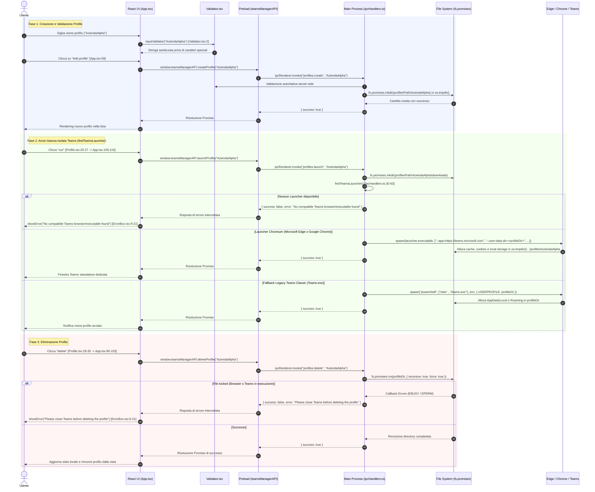

# Specifiche Funzionali: Gestione Istanze Multi-Profilo Microsoft Teams

Documentazione tecnica modulare redatta in conformità allo standard di progetto a 6 sezioni (`modular-documentation`).

---

## Sezione 1: Scopo del Modulo e Casi d'Uso Principali (User Stories)

### 1.1 Scopo Funzionale

Il modulo `instance-management` costituisce il nucleo operativo dell'applicazione `microsoft-teams-instances-manager`. Il suo obiettivo primario è consentire agli utenti desktop Windows di eseguire simultaneamente istanze multiple e indipendenti di Microsoft Teams. L'applicazione realizza un isolamento completo di sessione, cache, token di autenticazione e configurazioni per ciascun account o organizzazione aziendale, superando il limite nativo di Microsoft Teams che vincola l'utente a un'unica sessione desktop attiva alla volta.

La segregazione e il lancio delle istanze vengono gestiti mediante un'architettura ibrida a doppio livello:

1. **Launcher Moderno Chromium (`findTeamsLauncher`)**: Rileva automaticamente la presenza di Microsoft Edge (`msedge.exe`) o Google Chrome (`chrome.exe`) ed esegue l'interfaccia web moderna di Teams come applicazione standalone dedicata (`--app=https://teams.microsoft.com`), instradando storage, cache e cookie nella directory del profilo specificata tramite `--user-data-dir=<profileDir>` (con i flag difensivi `--no-first-run` e `--no-default-browser-check`).
2. **Fallback Legacy Teams Classic**: In assenza di browser Chromium compatibili, l'applicazione ripiega sull'eseguibile classico desktop `Teams.exe` (se presente in `%LOCALAPPDATA%\Microsoft\Teams\current\Teams.exe`), allocando il contesto isolato tramite deviazione della variabile d'ambiente `USERPROFILE=<profileDir>`.
3. **Segregazione dei Percorsi di Sistema**:
   - `profilesPath` e `logsPath` sono collocati nella cartella temporanea di Windows (`os.tmpdir()`, e.g. `%LOCALAPPDATA%\Temp\microsoft-teams-instances-manager\profiles` e `logs`), garantendo pulizia e isolamento volatile dei profili e della diagnostica.
   - `configPath` è archiviato nella cartella utente di roaming `%APPDATA%\microsoft-teams-instances-manager\config` (`file.config`), garantendo la persistenza affidabile delle preferenze applicative (`onStartup`, `autoLaunch`) attraverso i riavvii del sistema operativo.

### 1.2 User Stories Formattate

- **US-01 (Creazione Profilo)**: _Come_ consulente o dipendente multi-aziendale, _voglio_ creare un nuovo profilo con un nome personalizzato _affinché_ possa associare uno spazio di lavoro dedicato per una specifica organizzazione.
- **US-02 (Esecuzione Istanza Isolata Moderno/Legacy)**: _Come_ utente con molteplici credenziali aziendali, _voglio_ avviare una singola istanza Teams associata a un profilo _affinché_ possa partecipare a riunioni e chat di un tenant specifico in finestra standalone dedicata (via Microsoft Edge / Google Chrome o fallback Teams Classic) senza disconnettermi dagli altri account.
- **US-03 (Esecuzione Automatica all'Avvio)**: _Come_ utente frequente, _voglio_ che tutte le istanze dei profili configurati vengano avviate automaticamente all'apertura dell'applicazione o al login di Windows _affinché_ non debba avviare manualmente ogni singola istanza a ogni sessione lavorativa.
- **US-04 (Cancellazione Profilo)**: _Come_ utente, _voglio_ rimuovere un profilo non più necessario e i relativi dati su disco _affinché_ possa liberare spazio su filesystem e mantenere ordinata la lista dei tenant.
- **US-05 (Validazione Input)**: _Come_ utente, _voglio_ che i caratteri speciali non ammessi vengano automaticamente filtrati durante la digitazione del nome del profilo _affinché_ non vengano generati percorsi di file o parametri shell non validi o pericolosi.

### 1.3 Criteri di Accettazione (Gherkin Scenarios)

#### Scenario nominale 1: Creazione ed esecuzione di una nuova istanza profilo con launcher Chromium moderno

```gherkin
Dato che l'applicazione è avviata e l'utente visualizza la schermata principale
Quando l'utente inserisce "AziendaAlpha" nel campo di testo del profilo
E clicca sul pulsante "Add profile"
Allora viene creata la directory del profilo nel percorso temporaneo "AppData\Local\Temp\microsoft-teams-instances-manager\profiles\AziendaAlpha"
E il profilo "AziendaAlpha" compare nella lista dei profili disponibili
Quando l'utente clicca sul pulsante "run" del profilo "AziendaAlpha"
Allora viene verificata/creata la cartella "downloads" nel profilo temporaneo
E viene invocato "findTeamsLauncher()" che rileva "msedge.exe" (o in alternativa "chrome.exe")
E viene spawnato il processo standalone isolato con argomenti "--app=https://teams.microsoft.com", "--user-data-dir=<profileDir>", "--no-first-run", "--no-default-browser-check"
E l'istanza Teams si apre in una finestra dedicata separata.
```

#### Scenario nominale 2: Configurazione dell'avvio automatico e persistenza in AppData Roaming

```gherkin
Dato che l'utente ha configurato uno o più profili
Quando l'utente seleziona la checkbox "Run instances on startup"
Allora l'opzione "onStartup: true" viene salvata nel file "%APPDATA%\microsoft-teams-instances-manager\config\file.config"
E al successivo riavvio dell'applicazione ciascun profilo presente nella cartella temporanea "profiles" viene automaticamente eseguito in sequenza.
```

#### Scenario di errore 1: Tentativo di inserimento di un nome profilo duplicato

```gherkin
Dato che il profilo "ClienteBeta" è già presente nella lista
Quando l'utente digita "ClienteBeta" nel campo di testo
E clicca sul pulsante "Add profile"
Allora l'operazione di creazione viene bloccata
E viene visualizzato il banner rosso di errore con il messaggio "Name of the profile already used"
E il banner si chiude automaticamente dopo 5 secondi.
```

#### Scenario di errore 2: Tentativo di eliminazione di un profilo con istanza in esecuzione

```gherkin
Dato che il profilo "ClienteGamma" è in esecuzione con file di cache o browser attivi
Quando l'utente clicca sul pulsante "delete" del profilo "ClienteGamma"
Allora la rimozione della directory fallisce a causa del file lock di Windows
E l'applicazione intercetta l'errore del filesystem
E mostra il banner di errore: "Please close Teams before deleting the profile"
E il profilo rimane presente nell'interfaccia e su filesystem.
```

#### Scenario di errore 3: Nessun launcher Teams né browser compatibile rilevato nel sistema

```gherkin
Dato che l'host Windows non dispone né di Microsoft Edge, né di Google Chrome, né di Teams Classic in AppData
Quando l'utente clicca sul pulsante "run" di un profilo esistente
Allora la funzione "findTeamsLauncher()" restituisce null
E l'operazione di lancio fallisce restituendo l'errore controllato "No compatible Teams browser/executable found"
E l'applicazione mostra il messaggio di errore nella UI senza crash del Main Process.
```

---

## Sezione 2: Mappa dei Componenti UI / Operazioni Coinvolte

### 2.1 Tabella Componenti UI e Moduli IPC

| Nome Componente        | File Path (`file:line`)                      | Responsabilità Principale                                                                                                                                                                                                                                                                                                                                                                                                                        | Dipendenze / State Store collegato                                                                                                                             |
| :--------------------- | :------------------------------------------- | :----------------------------------------------------------------------------------------------------------------------------------------------------------------------------------------------------------------------------------------------------------------------------------------------------------------------------------------------------------------------------------------------------------------------------------------------- | :------------------------------------------------------------------------------------------------------------------------------------------------------------- |
| `Main`                 | `src/App.tsx:10`                             | Componente container dell'interfaccia React. Implementa il layout desktop a viewport confinato (`h-screen flex flex-col bg-background text-foreground overflow-hidden select-none`, `src/App.tsx:151`) conforme a `REQ-EL-04` per la finestra fissa 400x500px (`src/main.dev.ts:78-98`), con header controlli (`:155-168`), barra input (`:171-189`) e lista profili scrollabile (`main` in `flex-1 overflow-y-auto p-3 space-y-2`, `:191-200`). | React Hooks (`useState`, `useEffect`), `window.teamsManagerAPI`, `inputValidator`, `Profile`, `ErrorBox`, `src/components/ui/` (`Checkbox`, `Input`, `Button`) |
| `HomePage` / `App`     | `src/pages/index.tsx:6`<br>`src/App.tsx:205` | Entry point client Next.js 16 (`'use client'`) per l'esportazione statica (`output: 'export'`) e wrapper root di rendering React 19 (`src/index.tsx:7-8`).                                                                                                                                                                                                                                                                                       | `next`, `react`, `react-dom/client` (`createRoot`)                                                                                                             |
| `Profile`              | `src/components/Profile.tsx:9-39`            | Card semantica del profilo (`src/components/Profile.tsx:15-37`): contenitore flessibile (`p-2.5 rounded-lg border border-border bg-card shadow-sm hover:border-primary/40`), testo tronco (`truncate font-medium text-sm flex-1 pr-2`, `:16-18`) e pulsanti atomici "run" (`variant="default"`, `:20-27`) e "delete" (`variant="destructive"`, `:28-35`).                                                                                        | `src/components/ui/button.tsx` (`Button`), classi utility Tailwind CSS v3                                                                                      |
| `ErrorBox`             | `src/components/ErrorBox.tsx:9-21`           | Banner semantico di notifica errori ancorato alla sommità (`src/components/ErrorBox.tsx:15-19`). Incapsula il componente atomico `Alert` (`variant="destructive"`, `:16`) con `AlertDescription` (`:17`) e supporto alla dismissione manuale (`onClose`) e temporizzata (5s).                                                                                                                                                                    | `src/components/ui/alert.tsx` (`Alert`, `AlertDescription`), classi utility Tailwind CSS v3                                                                    |
| `Button` (Wrapper)     | `src/components/Button.tsx:16-36`            | Wrapper di compatibilità con interfaccia `ButtonProps:7-14` (`text`, `click`, `variant`, `size`). Inoltra eventi e gestisce varianti visive delegando direttamente al pulsante atomico UI.                                                                                                                                                                                                                                                       | `src/components/ui/button.tsx` (`Button as UIButton`)                                                                                                          |
| `UI Button`            | `src/components/ui/button.tsx:36-61`         | Componente atomico con `React.forwardRef`. Supporta varianti semantiche (`default`, `destructive`, `outline`, `secondary`, `ghost`, `:19-28`) e taglie (`default`, `sm`, `lg`, `:30-34`), con stati hover/focus ring integrati via Tailwind CSS v3.                                                                                                                                                                                              | `src/lib/utils.ts` (`cn`), Tailwind CSS v3                                                                                                                     |
| `UI Input`             | `src/components/ui/input.tsx:6-20`           | Campo di testo atomico con `React.forwardRef` (`InputProps:4`). Applica stile visuale conforme al design system (`border-input bg-card shadow-sm`, `:12-15`), focus-visible ring e placeholder theme-aware.                                                                                                                                                                                                                                      | `src/lib/utils.ts` (`cn`), Tailwind CSS v3                                                                                                                     |
| `UI Checkbox`          | `src/components/ui/checkbox.tsx:10-56`       | Controllo checkbox accessibile con `React.forwardRef` (`CheckboxProps:4-8`). Genera ID deterministico con `React.useId`, gestisce l'etichetta associata (`label`, `:42-52`) e gli stati interattivi/disabilitati.                                                                                                                                                                                                                                | `src/lib/utils.ts` (`cn`), Tailwind CSS v3                                                                                                                     |
| `UI Alert`             | `src/components/ui/alert.tsx:20-105`         | Primitiva atomica accessibile per notifiche e banner (`role="alert"`, `aria-live="assertive"`, `:36-37`). Fornisce varianti (`default`, `destructive`, `:14-18`), pulsante di chiusura (`onClose`, `:51-72`) e sotto-componenti tipizzati `AlertTitle` (`:81-92`) e `AlertDescription` (`:94-104`).                                                                                                                                              | `src/lib/utils.ts` (`cn`), Tailwind CSS v3                                                                                                                     |
| `Helper cn()`          | `src/lib/utils.ts:5-7`                       | Utility zero-runtime di composizione classi CSS: combina `clsx` (`:1-2`) per aggregazione condizionale e `tailwind-merge` (`:3`) per deduplicazione e risoluzione deterministica dei conflitti di specificità Tailwind.                                                                                                                                                                                                                          | `clsx`, `tailwind-merge`                                                                                                                                       |
| `Preload API`          | `src/preload.ts:1-14`                        | Bridge di sicurezza isolato (`contextIsolation: true`): espone l'interfaccia tipizzata `window.teamsManagerAPI` mediante `contextBridge.exposeInMainWorld`, inoltrando le richieste tramite `ipcRenderer.invoke`.                                                                                                                                                                                                                                | `electron` (`contextBridge`, `ipcRenderer`), `src/types/teams-api.d.ts`                                                                                        |
| `IPC Handlers`         | `src/main/ipcHandlers.ts:24-63, 65-315`      | Registrazione e gestione centralizzata nel Main Process di tutti i canali IPC (`profiles:*`, `settings:*`) e funzione di discovery launcher `findTeamsLauncher()`. Esegue in sicurezza le operazioni su filesystem e processi nativi.                                                                                                                                                                                                            | `electron` (`ipcMain`), `fs.promises`, `child_process.spawn`, `auto-launch`, `electron-log`, `ResourcesPath`, `Validator`                                      |
| `BrowserWindow / Tray` | `src/main.dev.ts:49-116, 201`                | Lifecycle nativo del Main Process (Electron 44.11.5): crea la finestra desktop con viewport fisso 400x500px (`:78-98`), applica `contextIsolation: true`, registra gli handler IPC (`:201`), gestisce la System Tray e gli aggiornamenti automatici.                                                                                                                                                                                             | `electron`, `electron-updater`, `electron-log`, `assets/icon.png`                                                                                              |

### 2.2 Tabella Operazioni di Sistema e File System

| Operazione / Servizio               | Handler (`file:line`)                                                 | Implementazione Tecnica                                                                                                                                                                                                                                                                                                                                                                                                                                             | Input / Output                                                                                                                                |
| :---------------------------------- | :-------------------------------------------------------------------- | :------------------------------------------------------------------------------------------------------------------------------------------------------------------------------------------------------------------------------------------------------------------------------------------------------------------------------------------------------------------------------------------------------------------------------------------------------------------ | :-------------------------------------------------------------------------------------------------------------------------------------------- |
| **Inizializzazione Workspace**      | `src/main/ipcHandlers.ts:69-71, 249-251`                              | Invocata all'avvio via `profiles:list` e `settings:get`. Assicura l'esistenza di `profilesPath` in `os.tmpdir()` (`os.tmpdir()\microsoft-teams-instances-manager\profiles`) e `configPath` in `%APPDATA%` (`%APPDATA%\microsoft-teams-instances-manager\config`) tramite `fs.promises.mkdir`.                                                                                                                                                                       | Nessun parametro; inizializza le directory su filesystem temporaneo (`profilesPath`) e roaming (`configPath`).                                |
| **Rilevamento Launcher Teams**      | `src/main/ipcHandlers.ts:30-63` (`findTeamsLauncher`)                 | Funzione interna di discovery. Valuta in sequenza candidati Microsoft Edge (`msedge.exe`), Google Chrome (`chrome.exe`) e fallback legacy Teams Classic (`Teams.exe` in `teamsPath`). Restituisce metadata launcher (`LauncherInfo`) oppure `null` se nessun eseguibile è presente.                                                                                                                                                                                 | Nessun parametro; restituisce `LauncherInfo \| null` (`{ type: 'edge' \| 'chrome' \| 'classic', name: string, executable: string }`).         |
| **Avvio Istanza Teams / Browser**   | `src/main/ipcHandlers.ts:172-244` (`profiles:launch`)                 | Handler IPC invocato da `src/App.tsx:105-116` (`onRun`). Prepara `downloads/` nel profilo temporaneo e invoca `findTeamsLauncher()`. Se non trovato, restituisce `{ success: false, error: 'No compatible Teams browser/executable found' }`. Per Edge/Chrome esegue spawn diretto `--app=https://teams.microsoft.com --user-data-dir=<profileDir> --no-first-run --no-default-browser-check`. Per Classic, fallback su PowerShell con `USERPROFILE: <profileDir>`. | `name: string`; avvia processo isolato o restituisce errore se nessun launcher è disponibile; output: `{ success: boolean, error?: string }`. |
| **Persistenza Configurazione**      | `src/main/ipcHandlers.ts:247-314` (`settings:get`, `settings:update`) | Handlers IPC invocati da `src/App.tsx:31, 127, 143`. Lettura e scrittura asincrona (`fs.promises`) del file `%APPDATA%\microsoft-teams-instances-manager\config\file.config`. Sincronizza lo stato di boot con `AutoLaunch`.                                                                                                                                                                                                                                        | `Settings` (`{ onStartup, autoLaunch }`); aggiorna `file.config` in roaming e chiave di autorun nel Registro di Windows.                      |
| **Aggiunta Profilo**                | `src/main/ipcHandlers.ts:88-127` (`profiles:create`)                  | Handler IPC invocato da `src/App.tsx:59-84` (`addProfile`). Valida con `inputValidator`, verifica l'assenza di duplicati e crea `profilesPath/<name>` e `downloads/` in `os.tmpdir()` tramite `fs.promises.mkdir`.                                                                                                                                                                                                                                                  | `name: string`; crea cartella profilo temporanea e restituisce `{ success: boolean, error?: string }`.                                        |
| **Rimozione Profilo**               | `src/main/ipcHandlers.ts:130-169` (`profiles:delete`)                 | Handler IPC invocato da `src/App.tsx:90-103` (`onDelete`). Rimuove la cartella del profilo con `await fs.promises.rm(profileDir, { recursive: true, force: true })` catturando eventuali errori di file lock (istanza aperta).                                                                                                                                                                                                                                      | `name: string`; elimina directory profilo temporanea e restituisce `{ success: boolean, error?: string }`.                                    |
| **Sanitizzazione Input**            | `src/utils/Validator.tsx:1-4` (`inputValidator`)                      | Rimuove caratteri speciali tramite espressione regolare `/[^a-zA-Z0-9 ]/g`. Applicata sia lato UI (`src/App.tsx:86-88`) che preventivamente nel Main Process (`src/main/ipcHandlers.ts:96, 138, 181`).                                                                                                                                                                                                                                                              | `text: string` -> `string` sanitizzata priva di caratteri proibiti.                                                                           |
| **Risoluzione Percorsi**            | `src/utils/ResourcesPath.tsx:1-38`                                    | Risolve con `path.join`: `teamsPath:6-12`, `homePath:14-17` (`os.tmpdir()`), `profilesPath:19-23` (`os.tmpdir()\...\profiles`), `logsPath:25-29` (`os.tmpdir()\...\logs`), `configPath:31-37` (`%APPDATA%\...\config`).                                                                                                                                                                                                                                             | `os.homedir()`, `os.tmpdir()`; stringhe di percorso assolute Windows normalizzate con `path.join`.                                            |
| **Logging Semantico Centralizzato** | `src/main/ipcHandlers.ts:6` (`import log from 'electron-log'`)        | Emette log semantici strutturati (`log.info`, `log.error`) su console e file rotativo `logsPath\log.log` in `os.tmpdir()` per tutte le operazioni IPC (`profiles:*`, `settings:*`). `src/utils/Logger.tsx:1-35` costituisce un modulo ausiliario.                                                                                                                                                                                                                   | `[IPC] <messaggio>`, parametri operativi ed errori formattati.                                                                                |

### 2.3 Architettura di Presentazione Zero-Runtime e Layout Desktop Confinato (REQ-EL-04)

A seguito della dismissione dell'eredità `styled-components` e della rimozione definitiva del modulo `src/components/FlexCSS.tsx`, l'applicazione adotta una pipeline di presentazione CSS zero-runtime basata su **Tailwind CSS v3** (`tailwind.config.js`, `postcss.config.js`, `src/styles/globals.css`).

#### 2.3.1 Helper di Composizione Deterministica: `cn()` (`src/lib/utils.ts:5-7`)

Tutti i componenti atomici e di dominio sfruttano l'helper `cn(...inputs: ClassValue[])` per:

- Valutazione condizionale delle classi tramite `clsx` (`src/lib/utils.ts:1-2`).
- Risoluzione deterministica dei conflitti di specificità CSS mediante `tailwind-merge` (`src/lib/utils.ts:3, 6`), garantendo che eventuali classi passate dall'esterno (`className`) sovrascrivano prevedibilmente le classi base predefinite.

#### 2.3.2 Catalogo Atomico (`src/components/ui/`) e Componenti Semantici di Dominio

L'interfaccia utente è interamente strutturata sul catalogo di componenti atomici modulari conforme alle linee guida di ergonomia desktop:

- **`Button` (`src/components/ui/button.tsx:36-61`)**: supporta varianti semantiche (`default`, `destructive`, `outline`, `secondary`, `ghost`, `:19-28`) e taglie (`default`, `sm`, `lg`, `:30-34`), integrando feedback cromatico per `hover`, `active` e ring accessibile `focus-visible`.
- **`Input` (`src/components/ui/input.tsx:6-20`)**: campo di input testuale con stili perimetrali coerenti con i token del tema (`border-input bg-card shadow-sm`, `:12-15`), focus ring e gestione disabilitazione.
- **`Checkbox` (`src/components/ui/checkbox.tsx:10-56`)**: casella di spunta accessibile con identificativo univoco automatico (`React.useId`) e associazione semantica della label (`:42-52`).
- **`Alert`, `AlertTitle`, `AlertDescription` (`src/components/ui/alert.tsx:20-105`)**: container di notifica con semantica WAI-ARIA (`role="alert"`, `aria-live="assertive"`, `:36-37`), varianti cromatiche (`default`, `destructive`, `:14-18`) e pulsante dismiss integrato (`:51-72`).
- **Card Profilo Semantica (`src/components/Profile.tsx:9-39`)**: raggruppa nome profilo e controlli in un layout flex orizzontale (`p-2.5 rounded-lg border border-border bg-card text-card-foreground shadow-sm hover:border-primary/40 transition-colors`, `:15`), prevenendo rotture grafiche tramite troncamento testuale (`truncate font-medium text-sm flex-1 pr-2`, `:16-18`) e azionamento atomico tramite bottoni `run` (`variant="default"`, `:20-27`) e `delete` (`variant="destructive"`, `:28-35`).
- **Banner Semantico Errori (`src/components/ErrorBox.tsx:9-21`)**: incapsula la primitiva `Alert` (`variant="destructive"`, `:16`) con auto-close temporizzato a 5 secondi gestito da timer React (`src/App.tsx:16-19`) e chiusura manuale immediata.

#### 2.3.3 Layout Desktop Confinato e Controllo Overflow (`REQ-EL-04`)

La finestra principale dell'applicazione desktop ha dimensioni fisse non ridimensionabili di **400x500px** (`src/main.dev.ts:78-98` con `width: 400`, `minWidth: 400`, `maxWidth: 400`, `height: 500`, `minHeight: 500`, `maxHeight: 500`).

In conformità al requisito ergonomico **`REQ-EL-04`** (Gestione dell'Overflow e Styling Scrollbars Desktop), `src/App.tsx:151-201` implementa una suddivisione rigorosa del layout per evitare scrollbar globali di finestra o scorrimenti orizzontali accidentali:

1. **Container Root a Viewport Bloccata (`src/App.tsx:151`)**:
   `<div className="h-screen flex flex-col bg-background text-foreground overflow-hidden select-none">`
   Blocca la pagina all'altezza esatta della finestra (`h-screen`), vieta lo scorrimento di pagina (`overflow-hidden`) e disabilita la selezione accidentale del testo (`select-none`) tipica delle applicazioni desktop native.
2. **Header Controlli Fisso (`src/App.tsx:155-168`)**:
   Barra di configurazione superiore (`p-3 border-b border-border bg-card/40 flex items-center justify-between gap-4`) contenente le checkbox `onStartup` e `autoLaunch`.
3. **Sezione Input Fissa (`src/App.tsx:171-189`)**:
   Barra di inserimento profilo orizzontale (`flex gap-2 p-3 border-b border-border`) con `Input` e `Button` ("Add profile").
4. **Area Scrollabile Indipendente dei Profili (`src/App.tsx:191-200`)**:
   `<main className="flex-1 overflow-y-auto p-3 space-y-2">`
   L'elenco dei profili occupa tutto lo spazio verticale residuo (`flex-1`) ed è l'unico elemento autorizzato allo scorrimento verticale (`overflow-y-auto`). L'utente può visualizzare e scorrere un numero arbitrario di profili mantenendo i controlli di configurazione e inserimento sempre fissi e visibili.

---

## Sezione 3: Flusso Funzionale End-to-End

### 3.1 Diagramma Visuale di Sequenza (Mermaid)



### 3.2 Descrizione Dettagliata Step-by-Step

1. **Bootstrapping Applicativo (`src/App.tsx:21-57`, `src/main/ipcHandlers.ts:65`)**:

   - All'avvio, il Main Process esegue `registerIpcHandlers()` prima della creazione della finestra (`src/main.dev.ts:201`).
   - Nel Renderer Process, l'hook `useEffect` esegue `loadInitialData()`, invocando contemporaneamente `window.teamsManagerAPI.getSettings()` e `window.teamsManagerAPI.getProfiles()`.
   - Se `settings.onStartup === true`, il client itera sui profili configurati e invoca asincronamente `window.teamsManagerAPI.launchProfile(profile)` per ciascuno di essi.

2. **Creazione Profilo e Doppia Sanitizzazione (`src/App.tsx:59-88`, `src/main/ipcHandlers.ts:88-127`)**:

   - Durante la digitazione nel campo di input, `handleProfileNameBox` applica in tempo reale `inputValidator` eliminando qualsiasi carattere non alfanumerico.
   - Alla pressione di "Add profile", viene verificata l'assenza del nome nello stato `profiles`.
   - La richiesta viene inviata al Main Process tramite `window.teamsManagerAPI.createProfile(profileName)`.
   - L'handler IPC valida nuovamente l'input e crea su disco la cartella del profilo e la sottodirectory `downloads` dentro `profilesPath` (`os.tmpdir()\microsoft-teams-instances-manager\profiles\<profileName>`). Al termine, la risposta `{ success: true }` permette alla UI di aggiornare lo stato e ripulire l'input.

3. **Esecuzione Istanza Isolata e Risoluzione Launcher (`src/App.tsx:105-116`, `src/main/ipcHandlers.ts:30-63, 172-244`)**:

   - Al click su "run", la UI invoca `window.teamsManagerAPI.launchProfile(profile)`.
   - L'handler IPC nel Main Process prepara la directory `downloads` all'interno della cartella temporanea del profilo ed esegue la risoluzione del launcher mediante `findTeamsLauncher()` (`src/main/ipcHandlers.ts:30-63`):
     1. **Rilevamento Microsoft Edge**: controlla l'esistenza di `msedge.exe` in `C:\Program Files (x86)\Microsoft\Edge\Application\msedge.exe` o `C:\Program Files\Microsoft\Edge\Application\msedge.exe`. Se presente, restituisce `{ type: 'edge', name: 'Microsoft Edge', executable: candidate }`.
     2. **Rilevamento Google Chrome**: controlla `chrome.exe` in `C:\Program Files\Google\Chrome\Application\chrome.exe` o `C:\Program Files (x86)\Google\Chrome\Application\chrome.exe`. Se presente, restituisce `{ type: 'chrome', name: 'Google Chrome', executable: candidate }`.
     3. **Fallback Teams Classic**: controlla l'eseguibile classico `%USERPROFILE%\AppData\Local\Microsoft\Teams\current\Teams.exe`. Se presente, restituisce `{ type: 'classic', name: 'Teams Classic', executable: teamsClassicExecutable }`.
     4. **Gestione Assenza Launcher**: se nessun eseguibile viene individuato, `findTeamsLauncher()` restituisce `null`. Il Main Process logga l'errore e restituisce `{ success: false, error: 'No compatible Teams browser/executable found' }`, intercettato dal frontend che mostra l'errore in `ErrorBox` senza anomalie o crash.
   - In presenza di Edge o Chrome (`launcher.type === 'edge' | 'chrome'`), esegue lo spawn diretto del binario in modalità standalone PWA con isolamento dello storage utente:
     ```typescript
     spawn(
       launcher.executable,
       [
         '--app=https://teams.microsoft.com',
         `--user-data-dir=${profileDir}`,
         '--no-first-run',
         '--no-default-browser-check',
       ],
       {
         detached: true,
         stdio: 'ignore',
       }
     ).unref();
     ```
   - In caso di fallback classico (`launcher.type === 'classic'`), esegue il lancio tramite PowerShell preservando la deviazione di ambiente `USERPROFILE`:
     ```typescript
     spawn('powershell', [`start '${launcher.executable}'`], {
       env: { ...process.env, USERPROFILE: profileDir },
       detached: true,
       stdio: 'ignore',
     }).unref();
     ```

4. **Rimozione Profilo e Rilevamento Conflitti (`src/App.tsx:90-103`, `src/main/ipcHandlers.ts:130-169`)**:
   - Al click su "delete", la UI invoca `window.teamsManagerAPI.deleteProfile(profile)`.
   - L'handler IPC tenta la rimozione ricorsiva della directory del profilo tramite `await fs.promises.rm(profileDir, { recursive: true, force: true })`. Se il browser o Teams è ancora in esecuzione, il lock sui file genera un'eccezione catturata che restituisce `{ success: false, error: 'Please close Teams before deleting the profile' }`.
   - La UI mostra il banner `ErrorBox` preservando il profilo nella lista. In caso di successo, il profilo viene rimosso dallo stato React.

---

## Sezione 4: Modello Dati e Regole di Business

### 4.1 Entità e Strutture Dati

#### Interfaccia `Settings` (`src/types/teams-api.d.ts:1-4`)

```typescript
export interface Settings {
  onStartup: boolean; // Se true, esegue tutte le istanze profilo all'avvio dell'app
  autoLaunch: boolean; // Se true, registra l'app nel registry di Windows per l'avvio al boot
}
```

#### Interfaccia `TeamsManagerAPI` (`src/types/teams-api.d.ts:6-13`)

```typescript
export interface TeamsManagerAPI {
  getProfiles(): Promise<string[]>;
  createProfile(name: string): Promise<{ success: boolean; error?: string }>;
  deleteProfile(name: string): Promise<{ success: boolean; error?: string }>;
  launchProfile(name: string): Promise<{ success: boolean; error?: string }>;
  getSettings(): Promise<Settings>;
  updateSettings(settings: Settings): Promise<void>;
}
```

#### Interfaccia `LauncherInfo` (`src/main/ipcHandlers.ts:24-28`)

Definisce i metadati descrittivi del launcher individuato da `findTeamsLauncher()`:

```typescript
export interface LauncherInfo {
  type: 'edge' | 'chrome' | 'classic'; // Tipologia di runtime
  name: string; // Nome esteso ('Microsoft Edge' | 'Google Chrome' | 'Teams Classic')
  executable: string; // Percorso assoluto dell'eseguibile rilevato
}
```

#### Persistenza su File: `%APPDATA%\microsoft-teams-instances-manager\config\file.config` (`src/main/ipcHandlers.ts:22, 253, 290`)

Il file di configurazione memorizza lo stato delle preferenze utente in formato JSON grezzo, garantendone la persistenza attraverso riavvii del sistema e sessioni utente grazie all'allocazione in roaming (`%APPDATA%`).

- **Formato**: JSON UTF-8
- **Valori di default**:
  ```json
  {
    "onStartup": true,
    "autoLaunch": true
  }
  ```

#### Struttura del Filesystem Locale (`src/utils/ResourcesPath.tsx:6-37`)

L'applicazione separa rigorosamente la configurazione permanente dai dati di sessione e log volatili:

```text
%APPDATA%\microsoft-teams-instances-manager\                    [configPath:31-37]
└── config\
    └── file.config                                            # Preferenze utente persistenti (onStartup, autoLaunch)

%LOCALAPPDATA%\Temp\microsoft-teams-instances-manager\         [os.tmpdir() - homePath:14-17]
├── logs\                                                      [logsPath:25-29]
│   └── log.log                                                # Log applicativo generato da electron-log (src/main/ipcHandlers.ts:6)
└── profiles\                                                  [profilesPath:19-23]
    ├── <ProfileName_1>\                                       # Directory isolata per il profilo 1
    │   ├── downloads\                                         # Cartella download locale del profilo
    │   └── <Dati Browser / Cache>\                            # Storage isolato Chromium (--user-data-dir) o AppData Teams
    └── <ProfileName_2>\
        └── ...
```

### 4.2 Regole di Validazione e Formule

1. **Rilevamento e Selezione Deterministica del Launcher (`src/main/ipcHandlers.ts:30-63`)**:

   - `findTeamsLauncher()` esegue una scansione sequenziale non-bloccante verificando l'esistenza dei percorsi tramite `fs.existsSync`:
     1. **Microsoft Edge (`msedge.exe`)**:
        - `C:\Program Files (x86)\Microsoft\Edge\Application\msedge.exe`
        - `C:\Program Files\Microsoft\Edge\Application\msedge.exe`
        - Se presente: restituisce `{ type: 'edge', name: 'Microsoft Edge', executable: candidate }`.
     2. **Google Chrome (`chrome.exe`)**:
        - `C:\Program Files\Google\Chrome\Application\chrome.exe`
        - `C:\Program Files (x86)\Google\Chrome\Application\chrome.exe`
        - Se presente: restituisce `{ type: 'chrome', name: 'Google Chrome', executable: candidate }`.
     3. **Teams Classic (`Teams.exe`)**:
        - `path.join(teamsPath, 'current', 'Teams.exe')` (`%USERPROFILE%\AppData\Local\Microsoft\Teams\current\Teams.exe`).
        - Se presente: restituisce `{ type: 'classic', name: 'Teams Classic', executable: teamsClassicExecutable }`.
     4. **Nessun Launcher Rilevato**:
        - Se nessun candidato esiste su disco, restituisce `null`.
        - L'handler IPC intercetta il valore `null`, scrive un log d'errore e restituisce `{ success: false, error: 'No compatible Teams browser/executable found' }` (`src/main/ipcHandlers.ts:195-203`).

2. **Parametri di Isolamento Standalone Chromium (`src/main/ipcHandlers.ts:219-231`)**:

   - Quando viene selezionato Edge o Chrome, il processo viene avviato con i seguenti switch CLI:
     - `--app=https://teams.microsoft.com`: avvia Teams Web moderno in modalità finestra applicativa (PWA/Standalone), eliminando barra degli indirizzi, schede e comandi del browser convenzionale.
     - `--user-data-dir=${profileDir}`: forza il motore Chromium a confinare cookies, local storage, indexedDB, cache e token di sessione all'interno della cartella profilo in `os.tmpdir()`, garantendo la completa segregazione tra tenant diversi.
     - `--no-first-run`: disabilita i wizard di configurazione iniziale del browser.
     - `--no-default-browser-check`: sopprime controlli e notifiche sul browser predefinito di Windows.

3. **Sanitizzazione Nomi Profili (`src/utils/Validator.tsx:1-4`)**:

   - Espressione regolare applicata: `/[^a-zA-Z0-9 ]/g` (`src/utils/Validator.tsx:1`).
   - Comportamento: sostituzione immediata (`text.replace(regex, '')`) di qualsiasi carattere non compreso tra `a-z`, `A-Z`, `0-9` o spazio con stringa vuota `''`.
   - **Regola di Business**: Sono ammessi esclusivamente caratteri alfanumerici ASCII e spazi. Caratteri come `\`, `/`, `:`, `*`, `?`, `"`, `<`, `>`, `|`, `;`, `&`, `$`, `%` sono categoricamente vietati per impedire percorsi filesystem non validi e iniezioni di parametri. La sanitizzazione viene eseguita in tempo reale nella UI (`src/App.tsx:86-88`) e rieseguita preventivamente come barriera difensiva nel Main Process (`src/main/ipcHandlers.ts:96, 138, 181`).

4. **Vincolo di Unicità del Profilo (`src/App.tsx:66-69`, `src/main/ipcHandlers.ts:108-110`)**:

   - Un nome profilo non può coincidere con un profilo già esistente (controllo preventivo nell'array locale `profiles.includes(profileName)` e verifica autoritativa dell'esistenza della cartella su disco nel Main Process con `fs.existsSync(profileDir)`).

5. **Auto-Launch del Sistema Operativo (`src/main/ipcHandlers.ts:13-15, 298-306`)**:
   - Gestito tramite la libreria `auto-launch` nel Main Process e sincronizzato automaticamente alla ricezione della chiamata IPC `settings:update`.
   - Se `settings.autoLaunch === true`, viene registrata una chiave nel Registro di Windows (`HKCU\Software\Microsoft\Windows\CurrentVersion\Run`).

---

## Sezione 5: Permessi e Matrice di Autorizzazione

### 5.1 Permessi del Sistema Operativo Host

L'applicazione richiede ed esercita i seguenti permessi a livello di sistema operativo host:

- **Accesso al File System Locale**:
  - Scrittura e lettura nella directory temporanea di sistema (`os.tmpdir()`, e.g. `%LOCALAPPDATA%\Temp\microsoft-teams-instances-manager\`) per la gestione e rimozione delle cartelle profilo (`profiles/<profileName>/`, `downloads/`) e l'aggiornamento dei log diagnostici (`logs/log.log`).
  - Scrittura e lettura nella directory roaming dell'utente (`%APPDATA%\microsoft-teams-instances-manager\config\`) per la persistenza del file di configurazione (`file.config`).
  - Tutte le operazioni di filesystem sono rigorosamente confinate al Main Process (`src/main/ipcHandlers.ts`) tramite API asincrone `fs.promises`.
- **Esecuzione Processi Figli (`child_process.spawn`)**:
  - Esecuzione distaccata (`detached: true, stdio: 'ignore'`) con dereferenziazione (`unref()`) dei binari browser Chromium (Microsoft Edge `msedge.exe`, Google Chrome `chrome.exe`) con argomenti CLI dedicati.
  - Invocazione subordinata di `powershell.exe` circoscritta al solo fallback di retrocompatibilità per Microsoft Teams Classic.
- **Registro di Windows (User-Level HKCU)**: Accesso in scrittura al ramo `HKEY_CURRENT_USER\Software\Microsoft\Windows\CurrentVersion\Run` via `auto-launch` per sincronizzare la chiave di avvio automatico al boot del sistema operativo.
- **Isolamento dei Dati e delle Variabili d'Ambiente**:
  - Per runtime Chromium (Edge/Chrome): isolamento garantito a livello di processo mediante lo switch CLI `--user-data-dir=${profileDir}`.
  - Per runtime Teams Classic: isolamento realizzato mediante deviazione esplicita della variabile d'ambiente `USERPROFILE: profileDir` nel contesto del processo figlio.

### 5.2 Matrice di Controllo Accessi (RBAC / Ruoli Operativi)

| Operazione / Risorsa                                     |        Utente Standard Desktop         | Amministratore di Sistema |                    Processo Teams / Browser Figlio                    |
| :------------------------------------------------------- | :------------------------------------: | :-----------------------: | :-------------------------------------------------------------------: |
| **Avvio Applicazione Manager**                           |               Consentito               |        Consentito         |                                  N/A                                  |
| **Creazione / Eliminazione Profilo**                     |               Consentito               |        Consentito         |                  Negato (Non ha accesso al Manager)                   |
| **Avvio Istanza Teams Dedicata**                         |               Consentito               |        Consentito         |                                  N/A                                  |
| **Modifica Opzioni di Autostart**                        |               Consentito               |        Consentito         |                                Negato                                 |
| **Accesso Dati Profilo (`os.tmpdir()...\profiles`)**     | Limitato alla propria directory utente |         Completo          | Confinato al proprio `profiles/<profileName>` (via `--user-data-dir`) |
| **Modifica File Configurazione (`%APPDATA%...\config`)** |   Consentito (gestito da UI via IPC)   |        Consentito         |                                Negato                                 |

### 5.3 Punti di Enforcement della Sicurezza (`Enforcement Points`)

- **Isolamento del Contesto e Sandbox**: `src/main.dev.ts:85-89` (`contextIsolation: true`, `nodeIntegration: false`, `preload: path.join(__dirname, 'preload.js')`).
- **Esposizione Controllata API (`contextBridge`)**: `src/preload.ts:1-14` (espone esclusivamente metodi asincroni tipizzati mappati su canali IPC dedicati).
- **Sanitizzazione Input Profilo**: `src/utils/Validator.tsx:2` (applicata a livello client in `src/App.tsx:86-88` e convalidata autoritativamente nel Main Process in `src/main/ipcHandlers.ts:96, 138, 181`).
- **Validazione e Discovery Launcher**: `src/main/ipcHandlers.ts:30-63, 193-203` (scansione percorsi candidati noti ed emissione errore bloccante controllato se nessun runtime compatibile è presente).
- **Separazione Contesti e Storage**:
  - Launcher Chromium: `src/main/ipcHandlers.ts:219-231` (spawn diretto con `--user-data-dir=${profileDir}`).
  - Launcher Classic: `src/main/ipcHandlers.ts:210-218` (spawn PowerShell con `USERPROFILE: profileDir`).
- **Controllo di Lock Filesystem**: `src/main/ipcHandlers.ts:150-160` (blocco protetto in `profiles:delete` che intercetta i lock attivi dei processi con `await fs.promises.rm(profileDir, { recursive: true, force: true })` restituendo errore controllato).

---

## Sezione 6: Gap Noti e Limiti di Implementazione

In conformità all'invariante di qualità di `modular-documentation`, le divergenze tra le best practice architetturali/standard di sicurezza e il codice sorgente implementato sono esposte in modo trasparente e rigoroso come gap formalmente risolti o limiti residui.

### 6.1 Analisi Tecnica dei Limiti Architetturali

1. **Risoluzione Definitiva di GAP-SEC-01 (Adozione `contextIsolation` e Preload IPC)**:
   A seguito della migrazione a **Electron 44.11.5**, **React 19.3.1** e **Next.js 16.4.6**, la configurazione di `BrowserWindow` (`src/main.dev.ts:85-89`) applica rigorosamente `contextIsolation: true`, `nodeIntegration: false` e il preload script dedicato `src/preload.ts:1-14`. Il Renderer Process è completamente disaccoppiato dal runtime Node.js e comunica con il sistema operativo esclusivamente mediante l'interfaccia fortemente tipizzata `window.teamsManagerAPI` (`src/types/teams-api.d.ts:6-13`). Tutte le operazioni di filesystem (`fs.promises`), avvio processi (`child_process.spawn`) e autorun (`auto-launch`) sono centralizzate in `src/main/ipcHandlers.ts:65-315`. Il gap di sicurezza GAP-SEC-01 è formalmente e definitivamente **RISOLTO**.

2. **Risoluzione Definitiva di GAP-ARCH-01 (Normalizzazione Percorsi con `path.join`)**:
   Il modulo `src/utils/ResourcesPath.tsx:6-37` adotta uniformemente `path.join()` per la composizione di tutti i percorsi di sistema (`teamsPath`, `homePath`, `profilesPath`, `logsPath`, `configPath`), eliminando qualsiasi concatenazione manuale di stringhe con backslash (`\\`). Il gap architetturale GAP-ARCH-01 è formalmente **RISOLTO**.

3. **Risoluzione di GAP-CODE-01 (Adozione Universale di `fs.promises.rm`)**:
   La rimozione delle cartelle profilo in `src/main/ipcHandlers.ts:151` adotta `await fs.promises.rm(profileDir, { recursive: true, force: true })`. Qualsiasi utilizzo residuo del metodo deprecato `fs.rmdir` è stato eliminato dal codebase. Il gap GAP-CODE-01 è formalmente **RISOLTO**.

4. **Risoluzione di GAP-FEAT-01 e GAP-ARCH-02 (Launcher Moderno Chromium e Spawn Diretto)**:

   - Con l'implementazione del launcher moderno `findTeamsLauncher()` (`src/main/ipcHandlers.ts:30-63`), l'applicazione supporta l'esecuzione di Microsoft Teams moderno appoggiandosi a Microsoft Edge (`msedge.exe`) o Google Chrome (`chrome.exe`) in modalità standalone PWA (`--app=https://teams.microsoft.com`). Questo supera la dipendenza dall'obsoleto client desktop Electron classico (`Teams.exe`) e aggira la complessità di packaging MSIX del "New Teams" desktop nativo. GAP-FEAT-01 è formalmente **RISOLTO**.
   - Per i runtime Chromium, lo spawn avviene direttamente senza passare per la shell (`spawn(launcher.executable, [...])`, `src/main/ipcHandlers.ts:219-231`), risolvendo GAP-ARCH-02 per il percorso nominale. L'invocazione tramite PowerShell (`:210-218`) è mantenuta unicamente come meccanismo di fallback per installazioni legacy di Teams Classic. GAP-ARCH-02 è formalmente **RISOLTO**.

5. **Limiti Residui Noti (Piattaforma Windows)**:

   - I candidati di discovery in `findTeamsLauncher()` e le directory di configurazione in `src/utils/ResourcesPath.tsx` sono orientati specificamente alla piattaforma Windows (`C:\Program Files`, `%APPDATA%`, `os.tmpdir()`). L'applicazione non supporta runtime macOS o Linux.

6. **Assenza di Tracking Attivo e Kill dei Processi Figli (`LIMIT-PROC-01`)**:
   - L'handler IPC `profiles:launch` (`src/main/ipcHandlers.ts:172-244`) effettua lo spawn dei processi browser PWA (Edge/Chrome) o PowerShell/Teams Classic in modalità distaccata con `child.unref()` (`src/main/ipcHandlers.ts:233`), senza mantenere un registro in memoria dei PID o istanze `ChildProcess`.
   - Di conseguenza, l'applicazione non monitora lo stato di vita (aperto/chiuso) delle istanze esterne e non espone comandi di arresto forzato (`kill`).
   - In caso di richiesta di eliminazione di un profilo mentre l'istanza Teams è ancora attiva, il tentativo di rimozione cartella tramite `await fs.promises.rm(profileDir, { recursive: true, force: true })` (`src/main/ipcHandlers.ts:151`) fallisce intercettando il vincolo di lock esclusivo imposto dal filesystem di Windows (`EBUSY`/`EPERM`). Il blocco catch (`:154-160`) restituisce all'utente il messaggio informativo controllato `"Please close Teams before deleting the profile"`, garantendo l'integrità dei dati senza provocare crash o eccezioni non gestite.

### 6.2 Tabella Gap e Limiti Tecnici

| ID Gap            | Descrizione Discrepanza / Limite                                                                                                                                                                                            | File/Area Coinvolta                                                                  | Severità / Stato | Piano di Risoluzione / Dettaglio Implementativo                                                                                                                                                                                                              |
| :---------------- | :-------------------------------------------------------------------------------------------------------------------------------------------------------------------------------------------------------------------------- | :----------------------------------------------------------------------------------- | :--------------: | :----------------------------------------------------------------------------------------------------------------------------------------------------------------------------------------------------------------------------------------------------------- |
| **GAP-SEC-01**    | Storica configurazione `nodeIntegration: true` senza `contextIsolation` nel Renderer.                                                                                                                                       | `src/main.dev.ts:85-89`<br>`src/preload.ts:1-14`<br>`src/main/ipcHandlers.ts:65-315` |   **Risolto**    | Implementato preload script tipizzato con `contextBridge` e registrazione canali IPC protetti nel Main Process.                                                                                                                                              |
| **GAP-ARCH-01**   | Concatenazione manuale di percorsi con backslash (`\\`) anziché `path.join()`.                                                                                                                                              | `src/utils/ResourcesPath.tsx:6-37`                                                   |   **Risolto**    | Normalizzati tutti i percorsi (`teamsPath`, `homePath`, `profilesPath`, `logsPath`, `configPath`) con `path.join()`.                                                                                                                                         |
| **GAP-ARCH-02**   | Esecuzione shell delegata a PowerShell anziché spawn diretto dell'eseguibile.                                                                                                                                               | `src/main/ipcHandlers.ts:219-231`                                                    |   **Risolto**    | Adottato spawn diretto del binario Chromium (`msedge.exe` / `chrome.exe`) con argomenti CLI dedicati. PowerShell conservato solo per fallback legacy Classic (:210-218).                                                                                     |
| **GAP-CODE-01**   | Uso residuo di fallback `fs.rmdir` ricorsivo anziché `fs.promises.rm`.                                                                                                                                                      | `src/main/ipcHandlers.ts:151`                                                        |   **Risolto**    | Adottato uniformemente `await fs.promises.rm(profileDir, { recursive: true, force: true })`.                                                                                                                                                                 |
| **GAP-FEAT-01**   | Mancanza di supporto a Microsoft Teams moderno (interfaccia web 2.1+ / architetture moderne).                                                                                                                               | `src/main/ipcHandlers.ts:30-63`                                                      |   **Risolto**    | Implementato `findTeamsLauncher()` con avvio PWA standalone su Edge e Chrome (`--app=https://teams.microsoft.com --user-data-dir=...`).                                                                                                                      |
| **LIMIT-OS-01**   | Supporto vincolato all'ambiente Windows (percorsi `Program Files`, `%APPDATA%` e Registro HKCU).                                                                                                                            | `src/utils/ResourcesPath.tsx:6-37`<br>`src/main/ipcHandlers.ts:31-51`                |    **Bassa**     | Limite architetturale noto: la natura dell'applicazione è attualmente circoscritta all'ecosistema Windows desktop. Nessun impatto sulle funzionalità previste per Windows.                                                                                   |
| **LIMIT-PROC-01** | Assenza di tracking dello stato d'esecuzione e del kill attivo dei processi figli Teams / Chromium; la rimozione dei profili con istanza aperta intercetta il lock del filesystem Windows invitando l'utente alla chiusura. | `src/main/ipcHandlers.ts:150-160, 233`                                               |    **Media**     | Vincolo architetturale noto: processi disaccoppiati con `child.unref()`. In eliminazione (`profiles:delete`), il lock Windows viene intercettato da `fs.promises.rm` con ritorno controllato dell'errore `"Please close Teams before deleting the profile"`. |
