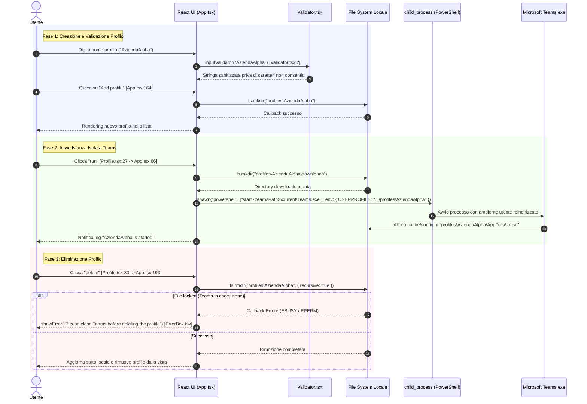

# Specifiche Funzionali: Gestione Istanze Multi-Profilo Microsoft Teams

Documentazione tecnica modulare redatta in conformità allo standard di progetto a 6 sezioni (`modular-documentation`).

---

## Sezione 1: Scopo del Modulo e Casi d'Uso Principali (User Stories)

### 1.1 Scopo Funzionale
Il modulo `instance-management` costituisce il nucleo operativo dell'applicazione `microsoft-teams-instances-manager`. Il suo obiettivo primario è consentire agli utenti desktop Windows di eseguire simultaneamente istanze multiple e indipendenti del client desktop Microsoft Teams (architettura classica Electron/Desktop). L'applicazione realizza un isolamento completo di sessione, cache, token di autenticazione e configurazioni per ciascun account o organizzazione aziendale, superando il limite nativo di Microsoft Teams che vincola l'utente a un'unica sessione desktop attiva alla volta.

La segregazione viene ottenuta dinamicamente mediante la deviazione della variabile d'ambiente `USERPROFILE` verso directory dedicate su filesystem locale per ogni profilo registrato (`profiles/<profileName>`), forzando l'eseguibile di Teams ad allocare `AppData\Local` e `AppData\Roaming` in contesti completamente isolati.

### 1.2 User Stories Formattate
- **US-01 (Creazione Profilo)**: *Come* consulente o dipendente multi-aziendale, *voglio* creare un nuovo profilo con un nome personalizzato *affinché* possa associare uno spazio di lavoro dedicato per una specifica organizzazione.
- **US-02 (Esecuzione Istanza Isolata)**: *Come* utente con molteplici credenziali aziendali, *voglio* avviare una singola istanza Teams associata a un profilo *affinché* possa partecipare a riunioni e chat di un tenant specifico senza disconnettermi dagli altri.
- **US-03 (Esecuzione Automatica all'Avvio)**: *Come* utente frequente, *voglio* che tutte le istanze dei profili configurati vengano avviate automaticamente al login di Windows o all'apertura dell'applicazione *affinché* non debba avviare manualmente ogni singola istanza a ogni sessione lavorativa.
- **US-04 (Cancellazione Profilo)**: *Come* utente, *voglio* rimuovere un profilo non più necessario e i relativi dati su disco *affinché* possa liberare spazio su filesystem e mantenere ordinata la lista dei tenant.
- **US-05 (Validazione Input)**: *Come* utente, *voglio* che i caratteri speciali non ammessi vengano automaticamente filtrati durante la digitazione del nome del profilo *affinché* non vengano generati percorsi di file o parametri shell non validi o pericolosi.

### 1.3 Criteri di Accettazione (Gherkin Scenarios)

#### Scenario nominale 1: Creazione ed esecuzione di una nuova istanza profilo
```gherkin
Dato che l'applicazione è avviata e l'utente visualizza la schermata principale
Quando l'utente inserisce "AziendaAlpha" nel campo di testo del profilo
E clicca sul pulsante "Add profile"
Allora viene creata la directory locale "profiles\AziendaAlpha"
E il profilo "AziendaAlpha" compare nella lista dei profili disponibili
Quando l'utente clicca sul pulsante "run" del profilo "AziendaAlpha"
Allora viene verificata/creata la cartella "profiles\AziendaAlpha\downloads"
E viene spawnato un processo PowerShell con USERPROFILE impostato sul percorso assoluto del profilo
E viene eseguito "Teams.exe" all'interno del contesto isolato.
```

#### Scenario nominale 2: Configurazione dell'avvio automatico delle istanze
```gherkin
Dato che l'utente ha configurato uno o più profili
Quando l'utente seleziona la checkbox "Run instances on startup"
Allora l'opzione "onStartup: true" viene salvata nel file "config\file.config"
E al successivo riavvio dell'applicazione ciascun profilo presente nella cartella "profiles" viene automaticamente eseguito in sequenza.
```

#### Scenario di errore 1: Tentativo di inserimento di un nome profilo duplicato
```gherkin
Dato che il profilo "ClienteBeta" è già presente nella lista
Quando l'utente digita "ClienteBeta" nel campo di testo
E clicca sul pulsante "Add profile"
Allora l'operazione di creazione viene bloccata
E viene visualizzato il banner rosso di errore con il messaggio "Name of the profile already used"
E il banner si chiude automaticamente dopo 5 secondi.
```

#### Scenario di errore 2: Tentativo di eliminazione di un profilo con istanza Teams in esecuzione
```gherkin
Dato che il profilo "ClienteGamma" è in esecuzione con Teams.exe attivo
Quando l'utente clicca sul pulsante "delete" del profilo "ClienteGamma"
Allora la rimozione della directory fallisce a causa del file lock di Windows
E l'applicazione intercetta l'errore del filesystem
E mostra il banner di errore: "Please close Teams before deleting the profile"
E il profilo rimane presente nell'interfaccia e su filesystem.
```

---

## Sezione 2: Mappa dei Componenti UI / Operazioni Coinvolte

### 2.1 Tabella Componenti UI

| Nome Componente | File Path (`file:line`) | Responsabilità Principale | Dipendenze / State Store collegato |
| :--- | :--- | :--- | :--- |
| `Main` | `src/App.tsx:26` | Componente radice dell'interfaccia. Gestisce lo stato globale dei profili (`profiles`), delle opzioni (`settings`), degli errori (`error`), la scansione delle cartelle su disco e l'avvio delle istanze Teams. | React Hooks (`useState`, `useEffect`), `fs`, `child_process`, `AutoLaunch`, `ResourcesPath`, `Logger` |
| `App` | `src/App.tsx:274` | Router root dell'applicazione Electron che incapsula la schermata principale `Main` all'interno di un `BrowserRouter`. | `react-router-dom` (`Router`, `Route`, `Switch`) |
| `Profile` | `src/components/Profile.tsx:18` | Renderizza la riga del singolo profilo con il nome formattato in overflow ed espone i pulsanti di azione "run" e "delete". | `src/components/Button.tsx`, `src/components/FlexCSS.tsx` (`ProfileCSS`, `LeftFlexTextCSS`, `FlexItem`) |
| `Button` | `src/components/Button.tsx:33` | Pulsante grafico riutilizzabile con animazione hover/active (`src/components/Button.tsx:18`) per l'interazione utente. | `styled-components` (`ButtonCSS:4`) |
| `ErrorBox` | `src/components/ErrorBox.tsx:21` | Banner fisso ancorato alla sommità dello schermo per la notifica tempestiva dei messaggi di errore (interfaccia `Props:18`). | `styled-components` (`ErrorBoxCSS:4`) |
| `FlexCSS` | `src/components/FlexCSS.tsx:1` | Primitive di layout Flexbox modulari (`Root:3`, `FlexItem:13`, `FlexBottomItem:21`, `Row:32`, `LeftFlexTextCSS:40`). | `styled-components` |
| `BrowserWindow / Tray` | `src/main.dev.ts:47` | Lifecycle nativo del Main Process Electron: crea la finestra `BrowserWindow`, gestisce la System Tray con menu contestuale (Show/Quit) e aggiornamenti `electron-updater`. | `electron`, `electron-updater`, `electron-log`, `assets/icon.png` |

### 2.2 Tabella Operazioni di Sistema e File System

| Operazione / Servizio | Handler (`file:line`) | Implementazione Tecnica | Input / Output |
| :--- | :--- | :--- | :--- |
| **Inizializzazione Workspace** | `src/App.tsx:38` (`init`) | Verifica e crea le cartelle `profilesPath` e `configPath` tramite `fs.existsSync` e `fs.mkdir`. | Nessun parametro; inizializza `./profiles` e `./config` su disco. |
| **Avvio Istanza Teams** | `src/App.tsx:66` (`onRun`) | Crea `profiles/<profile>/downloads` ed esegue `spawn('powershell', ['start <teamsPath>\\current\\Teams.exe'], { env: { USERPROFILE: <profileDir> } })`. | `profile: string`; esegue processo Teams con ambiente isolato. |
| **Persistenza Configurazione** | `src/App.tsx:82` (`loadConfig`)<br>`src/App.tsx:108` (`useEffect`) | Lettura sincrona (`fs.readFileSync`) e scrittura asincrona (`fs.writeFile`) di `config/file.config`. Sincronizza lo stato con `AutoLaunch`. | `Settings` (`{ onStartup, autoLaunch }`). |
| **Aggiunta Profilo** | `src/App.tsx:164` (`addProfile`) | Valida e crea la sottodirectory `profiles/<profileName>` tramite `fs.mkdir` prevenendo duplicati. | `profileNameBox: string`; aggiorna stato `profiles`. |
| **Rimozione Profilo** | `src/App.tsx:193` (`onDelete`) | Invoca `fs.rmdir(profilesPath/<profile>, { recursive: true })` catturando eventuali errori di file lock. | `profile: string`; elimina cartella su filesystem. |
| **Sanitizzazione Input** | `src/utils/Validator.tsx:2` (`inputValidator`) | Rimuove caratteri speciali tramite regex `new RegExp('[^a-zA-Z0-9 ]')` (`src/utils/Validator.tsx:1`). | `text: string` -> `string` sanitizzata priva di caratteri proibiti. |
| **Risoluzione Percorsi** | `src/utils/ResourcesPath.tsx:1` | Determina percorsi Windows per `teamsPath:5`, `homePath:7`, `profilesPath:9`, `logsPath:11`, `configPath:13`. | `os.homedir()`, `__dirname`; stringhe di percorso assolute. |
| **Logging Unificato** | `src/utils/Logger.tsx:20` (`Logger`) | Scrive log su file locale `logs\log.log` e console via `electron-log` (`src/utils/Logger.tsx:5`). | `text: string`, `level?: 'info' \| 'debug' \| 'error'`. |

---

## Sezione 3: Flusso Funzionale End-to-End

### 3.1 Diagramma Visuale di Sequenza (Mermaid)



### 3.2 Descrizione Dettagliata Step-by-Step

1. **Bootstrapping Applicativo (`src/App.tsx:135`)**:
   - All'avvio del renderer React viene invocato l'hook `useEffect` che esegue `init()` (`src/App.tsx:38`).
   - La funzione attende 1250ms, verifica e assicura l'esistenza delle directory `profiles` e `config` tramite `fs.existsSync` e `fs.mkdir`.
   - Viene richiamata `loadConfig()` (`src/App.tsx:82`): legge `config/file.config` su disco. Se il file non esiste, crea una configurazione di default con `{ onStartup: true, autoLaunch: true }`.
   - Se `onStartup` è `true`, l'applicazione effettua una scansione sincrona/asincrona di `profilesPath` (`src/App.tsx:140`) e avvia automaticamente ciascun profilo trovato invocando `onRun(file)`.

2. **Creazione Profilo e Sanitizzazione (`src/App.tsx:164`, `src/utils/Validator.tsx:2`)**:
   - Durante la digitazione nel campo di input, `handleProfileNameBox` (`src/App.tsx:189`) intercetta l'evento e chiama `inputValidator(target.value)`.
   - L'espressione regolare `[^a-zA-Z0-9 ]` elimina istantaneamente caratteri speciali, slash, backslash e simboli di escape shell.
   - Alla pressione del pulsante "Add profile", viene controllata l'univocità del nome nell'array di stato `profiles`. Se duplicato, viene invocata `showError("Name of the profile already used")`.
   - Viene eseguito `fs.mkdir(profilesPath + '\\' + profileName)` e, su callback positivo, il nuovo profilo viene accodato nello stato React.

3. **Esecuzione Istanza Isolata (`src/App.tsx:66`)**:
   - Al click su "run", `onRun(profile)` calcola il percorso assoluto della cartella del profilo e assicura l'esistenza della sottodirectory `downloads`.
   - Viene richiamato `child_process.spawn`:
     ```typescript
     spawn('powershell', [`start ${teamsPath}\\current\\Teams.exe`], {
       env: { USERPROFILE: profilesPath.concat('\\', profile) },
     });
     ```
   - L'override della variabile d'ambiente `USERPROFILE` è il perno architetturale dell'isolamento: il binario nativo di Teams, all'avvio, utilizza `USERPROFILE` per individuare `%USERPROFILE%\AppData\Local\Microsoft\Teams` e `%USERPROFILE%\AppData\Roaming\Microsoft\Teams`. Di conseguenza, tutti i cookie, token OAuth, log e database IndexedDB/LevelDB di Teams rimangono confinati nella directory `profiles\<profileName>`.

4. **Rimozione Profilo e Gestione Conflitti (`src/App.tsx:193`)**:
   - Al click su "delete", viene eseguito `fs.rmdir` ricorsivo sulla directory del profilo.
   - Se Teams è ancora aperto, il sistema operativo Windows mantiene attivi handle aperti sui database di cache (es. `Cookies`, `IndexedDB`), causando un errore di accesso. Il blocco catch intercetta l'eccezione e attiva il banner d'errore `ErrorBox` invitando l'utente a terminare prima il processo Teams.

---

## Sezione 4: Modello Dati e Regole di Business

### 4.1 Entità e Strutture Dati

#### Interfaccia `Settings` (`src/App.tsx:21-24`)
```typescript
interface Settings {
  onStartup: boolean;   // Se true, esegue tutte le istanze profilo all'avvio dell'app
  autoLaunch: boolean;  // Se true, registra l'app nel registry di Windows per l'avvio al boot
}
```

#### Persistenza su File: `config/file.config` (`src/App.tsx:86, 112`)
Il file di configurazione memorizza lo stato delle preferenze utente in formato JSON grezzo.
- **Formato**: JSON UTF-8
- **Valori di default**:
  ```json
  {
    "onStartup": true,
    "autoLaunch": true
  }
  ```

#### Struttura del Filesystem Locale (`src/utils/ResourcesPath.tsx:7-13`)
```text
<ApplicationDirectory>/
├── config/
│   └── file.config             # File JSON delle preferenze utente
├── logs/
│   └── log.log                 # Log applicativo generato da electron-log
└── profiles/
    ├── <ProfileName_1>/        # Cartella isolata per il profilo 1 (USERPROFILE)
    │   ├── downloads/          # Directory download configurata per Teams
    │   └── AppData/            # Cartella creata automaticamente da Teams.exe
    │       ├── Local/
    │       └── Roaming/
    └── <ProfileName_2>/
        └── ...
```

### 4.2 Regole di Validazione e Formule

1. **Sanitizzazione Nomi Profili (`src/utils/Validator.tsx:1-4`)**:
   - Espressione regolare applicata: `new RegExp('[^a-zA-Z0-9 ]')`.
   - Comportamento: sostituzione immediata (`replace`) di qualsiasi carattere non compreso tra `a-z`, `A-Z`, `0-9` o spazio con stringa vuota `''`.
   - **Regola di Business**: Sono ammessi esclusivamente caratteri alfanumerici ASCII e spazi. Caratteri come `\`, `/`, `:`, `*`, `?`, `"`, `<`, `>`, `|`, `;`, `&`, `$`, `%` sono categoricamente vietati per impedire percorsi filesystem non validi e iniezioni di comandi shell in PowerShell.
2. **Vincolo di Unicità del Profilo (`src/App.tsx:172-175`)**:
   - Un nome profilo non può coincidere con un profilo già esistente (case-sensitive nel controllo dell'array `profiles.includes(profileName)`).
3. **Auto-Launch del Sistema Operativo (`src/App.tsx:121-132`)**:
   - Gestito tramite la libreria `auto-launch` configurata con il nome e autore da `package.json` (`src/App.tsx:16-19`).
   - Se `settings.autoLaunch === true`, viene registrata una chiave nel Registro di Windows (`HKCU\Software\Microsoft\Windows\CurrentVersion\Run`).

---

## Sezione 5: Permessi e Matrice di Autorizzazione

### 5.1 Permessi del Sistema Operativo Host
L'applicazione richiede ed esercita i seguenti permessi a livello di sistema operativo host:
- **Accesso al File System Locale**: Lettura e scrittura nella cartella dell'applicazione (`__dirname`) per creare cartelle e file in `profiles/`, `config/`, e `logs/`.
- **Esecuzione Processi Figli (Shell/PowerShell)**: Capacità di invocare `powershell.exe` per lanciare processi esterni distaccati (`start ... Teams.exe`).
- **Registro di Windows (User-Level HKCU)**: Accesso in scrittura al ramo `HKEY_CURRENT_USER` per configurare la chiave di autorun all'avvio di Windows (privilegi standard, non richiede elevazione amministrativa UAC).
- **Isolamento delle Variabili d'Ambiente**: Assegnazione esplicita della variabile d'ambiente `USERPROFILE` nel blocco opzioni del processo figlio senza alterare le variabili d'ambiente globali dell'utente host.

### 5.2 Matrice di Controllo Accessi (RBAC / Ruoli Operativi)

| Operazione / Risorsa | Utente Standard Desktop | Amministratore di Sistema | Processo Teams Figlio |
| :--- | :---: | :---: | :---: |
| **Avvio Applicazione Manager** | Consentito | Consentito | N/A |
| **Creazione / Eliminazione Profilo** | Consentito | Consentito | Negato (Non ha accesso al Manager) |
| **Avvio Istanza Teams Dedicata** | Consentito | Consentito | N/A |
| **Modifica Opzioni di Autostart** | Consentito | Consentito | Negato |
| **Accesso Dati Profilo (`AppData`)** | Limitato alla propria directory utente | Completo | Confinato al proprio `profiles/<profileName>` |
| **Modifica File di Configurazione (`file.config`)** | Consentito (gestito da UI) | Consentito | Negato |

### 5.3 Punti di Enforcement della Sicurezza (`Enforcement Points`)
- **Sanitizzazione Input Profilo**: `src/utils/Validator.tsx:2` (impedisce path traversal e command injection prima di qualsiasi chiamata al filesystem o alla shell).
- **Separazione Contesti Teams**: `src/App.tsx:77` (`{ env: { USERPROFILE: profilesPath.concat('\\', profile) } }`).
- **Controllo di Lock Filesystem**: `src/App.tsx:195` (blocco protetto in `onDelete` che rileva file aperti o lock di sistema operativo impedendo corruzioni).

---

## Sezione 6: Gap Noti e Limiti di Implementazione

In conformità all'invariante di qualità di `modular-documentation`, le divergenze tra le best practice architetturali/standard di sicurezza e il codice sorgente implementato sono esposte in modo trasparente e rigoroso come gap aperti.

### 6.1 Analisi Tecnica dei Limiti Architetturali

1. **Abilitazione di `nodeIntegration: true` e Mancanza di `contextIsolation`**:
   Nel processo principale (`src/main.dev.ts:81-83`), la finestra `BrowserWindow` viene istanziata con:
   ```typescript
   const webPreferences = {
     nodeIntegration: true,
   };
   ```
   Questa configurazione disabilita la sandbox di Electron e non specifica `contextIsolation: true`. L'interfaccia React importa direttamente moduli nativi di Node.js (`fs`, `child_process`) nel renderer process. Sebbene l'applicazione non carichi contenuti remoti né consenta navigazione web non verificata, la best practice moderna di Electron (v12+) prescrive `contextIsolation: true`, `nodeIntegration: false` e l'uso di un preload script con `contextBridge` e IPC.

2. **Dipendenza Rigida da Piattaforma Windows e Separatori Hardcoded (`\\`)**:
   Nei percorsi in `src/utils/ResourcesPath.tsx` (`:5, :7, :9, :11, :13`) e in `src/App.tsx` (`:67, :68, :76, :86, :112, :145, :166, :194`), viene fatto uso esclusivo di concatenazioni di stringhe con il separatore Windows `\\` invece di utilizzare il modulo standard `path.join()` o `path.resolve()`. Inoltre, la risoluzione dell'eseguibile di Teams punta unicamente a `%USERPROFILE%\AppData\Local\Microsoft\Teams\current\Teams.exe`. L'applicazione non supporta nativamente macOS o Linux né la nuova versione "Teams 2.0" basata su pacchetti MSIX (`ms-teams.exe`).

3. **Invocazione PowerShell Non Parametrizzata**:
   In `src/App.tsx:76-78`, l'avvio di Teams avviene tramite `spawn('powershell', ['start <path>\\current\\Teams.exe'])`. Sebbene l'input sia validato da `inputValidator`, l'uso di un comando stringa concatenato passato all'argomento `start` di PowerShell introduce una dipendenza diretta dalla presenza di PowerShell nel PATH e non gestisce direttamente gli handle del processo nativo (PID di Teams), rendendo impossibile per il Manager sapere se un'istanza è attualmente in esecuzione o terminata.

4. **Gestione Asincrona Non Omogenea e Deprecazione `fs.rmdir`**:
   - In `src/App.tsx:38` (`init`), le chiamate a `fs.mkdir` (`:46, :55`) utilizzano callback asincrone non attese (`await`), rendendo i ritardi `sleep(1250)` (`:43, :63`) un workaround basato su timing anziché su promesse deterministiche (`fs.promises.mkdir`).
   - In `src/App.tsx:194`, viene utilizzato `fs.rmdir` con `{ recursive: true }`, opzione deprecata nelle versioni recenti di Node.js a favore di `fs.rm`.
   - In `src/App.tsx:101-102`, è presente un errore di battitura logico: `if (json.autoLaunch === null) json.onStartup = true;` (assegna `onStartup` anziché `autoLaunch`).

### 6.2 Tabella Gap e Limiti Tecnici

| ID Gap | Descrizione Discrepanza | File/Area Coinvolta | Severità | Piano di Risoluzione Suggerito |
| :--- | :--- | :--- | :---: | :--- |
| **GAP-SEC-01** | `nodeIntegration: true` attivo nel Renderer Process senza `contextBridge` / `contextIsolation`. | `src/main.dev.ts:81-83`<br>`src/App.tsx:2, 5` | **Alta** | Migrare a `contextIsolation: true`, disabilitare `nodeIntegration` e incapsulare le operazioni di filesystem/processi in un preload script esponendo un'API sicura via `ipcRenderer` / `ipcMain`. |
| **GAP-ARCH-01** | Concatenazione manuale di percorsi con backslash (`\\`) anziché `path.join()`. | `src/utils/ResourcesPath.tsx:5-13`<br>`src/App.tsx:67, 86, 112` | **Media** | Sostituire tutte le concatenazioni `concat('\\', ...)` con `path.join(...)` garantendo portabilità e prevenendo percorsi malformati. |
| **GAP-ARCH-02** | Esecuzione shell delegata a PowerShell anziché spawn diretto dell'eseguibile Teams. | `src/App.tsx:76-78` | **Media** | Utilizzare `spawn(teamsExecutablePath, [], { detached: true, env: customEnv })` catturando direttamente il PID del processo per il monitoraggio dello stato di esecuzione. |
| **GAP-CODE-01** | Uso di `fs.rmdir(..., { recursive: true })` deprecato e race condition in `init()`. | `src/App.tsx:38-64`<br>`src/App.tsx:194` | **Bassa** | Adottare `fs.promises` (`await fs.promises.mkdir`, `await fs.promises.rm(dir, { recursive: true, force: true })`) rimuovendo gli `sleep` empirici. |
| **GAP-CODE-02** | Refuso logico nell'inizializzazione del fallback di configurazione (`json.autoLaunch`). | `src/App.tsx:102` | **Bassa** | Correggere la condizione in `if (json.autoLaunch === null) json.autoLaunch = true;`. |
| **GAP-FEAT-01** | Mancanza di supporto a "New Microsoft Teams" (architettura Windows App SDK / MSIX). | `src/utils/ResourcesPath.tsx:5` | **Media** | Introdurre rilevamento automatico del binario Teams tra Classic (`Teams.exe` in AppData) e New Teams (`ms-teams.exe` o URI scheme `msteams:`). |
