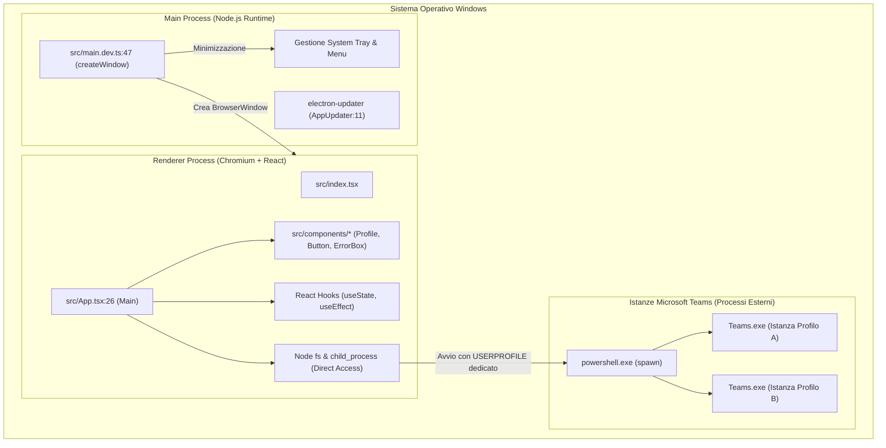

# Standard Architetturale: Baseline e Modello Operativo

Questo documento definisce i principi architetturali, i confini di processo, il modello di isolamento e le politiche di sicurezza per l'applicazione desktop `microsoft-teams-instances-manager`.

---

## 1. Architettura a Due Processi di Electron

L'applicazione adotta l'architettura classica multi-processo di Electron, suddivisa in due livelli funzionali distinti:



### 1.1 Processo Principale (Main Process)
- **Entry Point**: `src/main.dev.ts:47` (`createWindow`).
- **Ambiente di Esecuzione**: Node.js completo.
- **Responsabilità**:
  - Inizializzazione e gestione del ciclo di vita della finestra `BrowserWindow` (`src/main.dev.ts:86-110`).
  - Ridimensionamento dinamico in base all'ambiente: larghezza 400px (altezza 500px) in produzione; larghezza 1000px in modalità sviluppo (`NODE_ENV === 'development'`) con estensioni React Developer Tools (`src/main.dev.ts:34-45`).
  - Gestione della barra di stato di sistema (System Tray, `src/main.dev.ts:127-140`) con menu contestuale per ripristinare la finestra ("Show App") o terminare l'applicazione ("Quit").
  - Intercettazione della navigazione esterna sicura: impedisce il reindirizzamento della finestra web delegando l'apertura degli URL al browser predefinito dell'utente tramite `shell.openExternal` (`src/main.dev.ts:149-152`).
  - Monitoraggio e gestione degli aggiornamenti automatici tramite `electron-updater` e `AppUpdater` (`src/main.dev.ts:11-17, 184-204`).

### 1.2 Processo di Rendering (Renderer Process)
- **Entry Point**: `src/index.tsx` e `src/App.tsx:26` (`Main`).
- **Ambiente di Esecuzione**: React 17 con TypeScript e accesso ai moduli nativi Node.js tramite `nodeIntegration: true`.
- **Responsabilità**:
  - Presentazione dell'interfaccia utente grafica reattiva, visualizzazione della lista profili e gestione interazioni (click su run/delete, aggiunta nuovi tenant).
  - Orchestrazione dello stato applicativo tramite React Hooks (`useState`, `useEffect`).
  - Accesso diretto al filesystem tramite `fs` per la creazione/eliminazione delle directory dei profili e lettura/scrittura dei file di configurazione (`config/file.config`).
  - Invocazione diretta dei processi di sistema operativo tramite `child_process.spawn`.

---

## 2. Modello di Isolamento Multi-Istanza

Microsoft Teams classico vincola per progettazione l'utente a un'unica sessione desktop per account di Windows, memorizzando credenziali OAuth, cache Chromium, IndexedDB e socket di sessione all'interno del percorso standard `%LOCALAPPDATA%\Microsoft\Teams` e `%APPDATA%\Microsoft\Teams`.

### 2.1 Principio di Deviazione della Variabile d'Ambiente `USERPROFILE`
Per garantire la totale indipendenza delle istanze senza richiedere containerizzazione o macchine virtuali, l'architettura sfrutta il meccanismo nativo di Windows basato sulla variabile d'ambiente `USERPROFILE`:

```typescript
// src/App.tsx:76-78
spawn('powershell', [`start ${teamsPath}\\current\\Teams.exe`], {
  env: { USERPROFILE: profilesPath.concat('\\', profile) },
});
```

1. Quando `spawn` invoca `powershell`, viene creata una tabella delle variabili d'ambiente ad-hoc per quel processo figlio.
2. In tale tabella, `USERPROFILE` viene ridefinita sul percorso assoluto della cartella specifica del profilo: `<homePath>\profiles\<profileName>`.
3. Quando l'eseguibile `Teams.exe` viene avviato, interroga l'ambiente di processo per risolvere `AppData\Local` e `AppData\Roaming`.
4. Di conseguenza, Teams alloca e consulta i propri file di stato all'interno di:
   - `<homePath>\profiles\<profileName>\AppData\Local\Microsoft\Teams`
   - `<homePath>\profiles\<profileName>\AppData\Roaming\Microsoft\Teams`
5. Ciascuna istanza possiede una cache indipendente, un token store crittografato isolato e un database cookie separato. È possibile eseguire simultaneamente $N$ istanze attive collegate a tenant Azure AD differenti.

---

## 3. Struttura dello Storage Locale e Risoluzione Percorsi

I percorsi applicativi sono determinati dinamicamente nel modulo `src/utils/ResourcesPath.tsx`:

| Identificatore | File e Linea | Calcolo del Percorso | Scopo Architetturale |
| :--- | :--- | :--- | :--- |
| `userPath` | `src/utils/ResourcesPath.tsx:3` | `os.homedir()` | Individua la home directory dell'utente Windows corrente (es. `C:\Users\<Username>`). |
| `teamsPath` | `src/utils/ResourcesPath.tsx:5` | `${userPath}\AppData\Local\Microsoft\Teams` | Percorso dell'installazione classica del binario di Microsoft Teams. |
| `homePath` | `src/utils/ResourcesPath.tsx:7` | `__dirname.substring(0, __dirname.lastIndexOf('\\'))` | Cartella radice dell'applicazione (o cartella superiore a `src/dist`). |
| `profilesPath`| `src/utils/ResourcesPath.tsx:9` | `${homePath}\profiles` | Directory contenitore di tutte le cartelle profilo isolate. |
| `logsPath` | `src/utils/ResourcesPath.tsx:11`| `${homePath}\logs` | Directory di destinazione per i log di diagnostica (`logs\log.log`). |
| `configPath` | `src/utils/ResourcesPath.tsx:13`| `${homePath}\config` | Directory contenente il file JSON di configurazione `config\file.config`. |

### Gerarchia Filesystem a Runtime
```text
<homePath>/
├── config/
│   └── file.config             # Preferenze utente: {"onStartup": true, "autoLaunch": true}
├── logs/
│   └── log.log                 # Log rotativo di electron-log
└── profiles/
    ├── Azienda_A/
    │   ├── downloads/          # Directory predisposta per i file scaricati da Teams
    │   └── AppData/            # Generato automaticamente dal processo Teams.exe
    │       ├── Local/Microsoft/Teams/
    │       └── Roaming/Microsoft/Teams/
    └── Azienda_B/
        ├── downloads/
        └── AppData/
```

---

## 4. Ciclo di Vita Applicativo e Avvio al Boot

### 4.1 Sequenza di Avvio (Startup Sequence)
1. **Inizializzazione Main Process (`src/main.dev.ts:171`)**:
   - `app.whenReady()` crea la finestra principale `createWindow()`.
   - Se la variabile d'ambiente `START_MINIMIZED` è presente, la finestra viene immediatamente minimizzata nel System Tray (`src/main.dev.ts:120`). In caso contrario viene mostrata e portata in primo piano (`mainWindow.show()`).
2. **Mounting del Renderer Process (`src/App.tsx:135-157`)**:
   - Viene eseguita la funzione asincrona `init()` (`src/App.tsx:38`), che assicura la presenza su disco delle cartelle `profiles` e `config`.
   - Viene invocata `loadConfig()` (`src/App.tsx:82`): carica le impostazioni da `config/file.config`. Se non presente, genera il default `{ onStartup: true, autoLaunch: true }`.
   - Se `onStartup === true`, viene effettuata la scansione di `profilesPath` (`src/App.tsx:140`): ogni sottocartella valida viene inserita nello stato React e contestualmente avviata tramite `onRun(file)`.

### 4.2 Minimizzazione e Integrazione System Tray
- Alla ricezione dell'evento `minimize` della finestra (`src/main.dev.ts:127-140`):
  - L'istanza di `mainWindow` viene nascosta (`mainWindow.hide()`).
  - Viene istanziata l'icona di notifica `Tray` nella barra di sistema con l'icona `assets/icon.png`.
  - Il doppio click sull'icona della tray ripristina la visualizzazione della finestra (`mainWindow.show()`).
  - Il menu contestuale espone i controlli "Show App" e "Quit".

### 4.3 Registrazione nel Sistema Operativo via `AutoLaunch`
- L'integrazione di avvio automatico all'accesso di Windows è gestita dal modulo `auto-launch` (`src/App.tsx:16-19`):
  - Sincronizzata all'interno dello `useEffect([settings])` (`src/App.tsx:108-133`).
  - Se `settings.autoLaunch === true`, `AutoLauncher.enable()` scrive la chiave di avvio nel registro utente (`HKCU\Software\Microsoft\Windows\CurrentVersion\Run`).
  - Se `settings.autoLaunch === false`, `AutoLauncher.disable()` rimuove la voce di registro.

---

## 5. Politiche di Sicurezza e Roadmap di Migrazione

### 5.1 Valutazione dello Stato Corrente (Baseline)
Nell'implementazione attuale, la finestra principale Electron è configurata con:
```typescript
// src/main.dev.ts:81-83
const webPreferences = {
  nodeIntegration: true,
};
```

- **Vulnerabilità / Limite**: L'assenza di `contextIsolation: true` e l'abilitazione di `nodeIntegration: true` concedono al processo di rendering privilegi completi di esecuzione del sistema operativo (accesso diretto a `fs` e `child_process`).
- **Fattore Mitigante Attuale**: L'applicazione non esegue codice remoto né carica URL esterne all'interno del proprio contesto Chromium (`mainWindow.loadURL('file://...')`). Tutti i link esterni sono forzati ad aprirsi nel browser predefinito del sistema (`src/main.dev.ts:149-152`). Inoltre, tutti i nomi dei profili sono rigorosamente sanitizzati da `src/utils/Validator.tsx:2`.

### 5.2 Piano di Migrazione verso gli Standard di Sicurezza Electron Moderni (Target)
Per conformarsi alle best practice ufficiali di sicurezza di Electron, l'architettura futura dovrà implementare la seguente separazione a privilegi minimi:

1. **Disabilitazione di `nodeIntegration` e Attivazione di `contextIsolation`**:
   ```typescript
   // Target src/main.dev.ts
   webPreferences: {
     nodeIntegration: false,
     contextIsolation: true,
     preload: path.join(__dirname, 'preload.js'),
   }
   ```
2. **Preload Script con `contextBridge` (`src/preload.ts`)**:
   Esporre esclusivamente funzioni sicure e fortemente tipizzate al renderer:
   ```typescript
   import { contextBridge, ipcRenderer } from 'electron';

   contextBridge.exposeInMainWorld('teamsManagerAPI', {
     getProfiles: () => ipcRenderer.invoke('profiles:list'),
     createProfile: (name: string) => ipcRenderer.invoke('profiles:create', name),
     deleteProfile: (name: string) => ipcRenderer.invoke('profiles:delete', name),
     launchProfile: (name: string) => ipcRenderer.invoke('profiles:launch', name),
     getSettings: () => ipcRenderer.invoke('settings:get'),
     updateSettings: (settings: Settings) => ipcRenderer.invoke('settings:update', settings),
   });
   ```
3. **IPC Handlers nel Main Process**:
   Spostare tutte le operazioni di `fs`, `child_process.spawn` e `auto-launch` nel Main Process, validando ogni parametro in ingresso prima dell'esecuzione.
