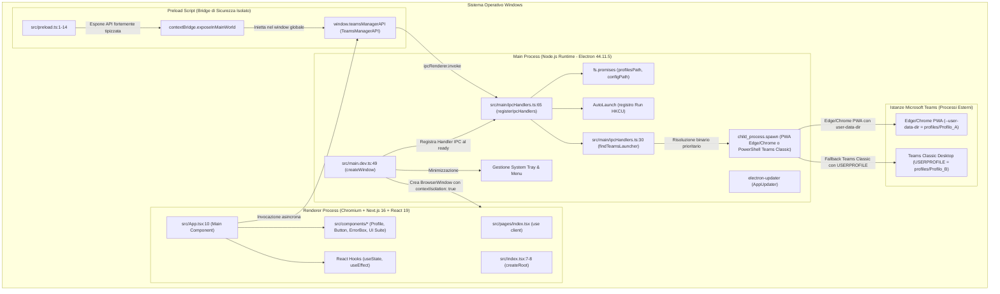

# Standard Architetturale: Baseline e Modello Operativo

Questo documento definisce i principi architetturali, i confini di processo, il modello di isolamento e le politiche di sicurezza per l'applicazione desktop `microsoft-teams-instances-manager`.

---

## 1. Architettura a Tre Livelli di Electron (Main, Preload, Renderer)

A seguito della migrazione a **Electron 44.11.5**, **React 19.3.1** e **Next.js 16.4.6** (con esportazione statica `output: 'export'`), l'applicazione adotta l'architettura a tre livelli con isolamento del contesto (`contextIsolation: true`) e disabilitazione di `nodeIntegration`:



### 1.1 Processo Principale (Main Process)

- **Entry Point**: `src/main.dev.ts:49` (`createWindow`) e `src/main.dev.ts:186` (`registerIpcHandlers`).
- **Ambiente di Esecuzione**: Node.js completo sotto runtime Electron 44.11.5.
- **Responsabilità**:
  - Inizializzazione e gestione del ciclo di vita della finestra `BrowserWindow` (`src/main.dev.ts:89-112`) con opzioni di sicurezza restrittive (`nodeIntegration: false`, `contextIsolation: true`, `preload: path.join(__dirname, 'preload.js')`).
  - Ridimensionamento dinamico in base all'ambiente: larghezza fissa 400px (altezza 500px) in produzione; larghezza 1000px in modalità sviluppo (`NODE_ENV === 'development'`) con caricamento di React Developer Tools (`src/main.dev.ts:36-47`).
  - Gestione della barra di stato di sistema (System Tray, `src/main.dev.ts:129-142`) con menu contestuale per ripristinare la visualizzazione ("Show App") o terminare l'applicazione ("Quit").
  - Intercettazione della navigazione esterna sicura: impedisce il reindirizzamento della finestra web delegando l'apertura degli URL esterni al browser predefinito di sistema tramite `shell.openExternal` (`src/main.dev.ts:151-154`).
  - Monitoraggio e gestione degli aggiornamenti automatici tramite `electron-updater` e `AppUpdater` (`src/main.dev.ts:13-19, 202-222`).
  - Esecuzione centralizzata e sicura di tutte le operazioni di I/O (filesystem `fs.promises`, avvio processi `child_process.spawn`, sincronizzazione registro con `auto-launch`, logging con `electron-log`) mediante IPC Handlers dedicati (`src/main/ipcHandlers.ts:65-315`).
  - **Strategia Multi-Launcher Moderna (`src/main/ipcHandlers.ts:30-63, 172-244`)**:
    - **Rilevamento Prioritario PWA (Edge / Chrome)**: Tramite `findTeamsLauncher()` (`src/main/ipcHandlers.ts:30-63`), l'applicazione interroga prioritariamente l'installazione a 64/32-bit di Microsoft Edge (`msedge.exe`) e, in subordine, Google Chrome (`chrome.exe`).
    - **Isolamento Sessioni e Cookie PWA**: Se rilevato un browser Chromium, l'istanza viene avviata in modalità PWA dedicata con argomenti `--app=https://teams.microsoft.com`, `--user-data-dir=${profileDir}`, `--no-first-run` e `--no-default-browser-check`, confinando cookie, cache e sessioni OAuth nella directory specifica del profilo.
    - **Fallback Teams Classic Desktop**: Qualora nessun browser Chromium sia disponibile, il launcher verifica la presenza di Teams Classic Desktop (`teamsPath\current\Teams.exe`) e ne orchestra l'avvio isolato via `powershell` con variabile d'ambiente `USERPROFILE: profileDir`.
    - In entrambe le modalità, il processo figlio viene generato con `detached: true`, `stdio: 'ignore'` e disaccoppiato mediante `child.unref()` (`src/main/ipcHandlers.ts:233`).

### 1.2 Processo di Rendering (Renderer Process)

- **Entry Point**: `src/pages/index.tsx:6` (`HomePage`), `src/index.tsx:7-8` (`createRoot`) e `src/App.tsx:10` (`Main`).
- **Ambiente di Esecuzione**: Next.js 16.4.6 (renderer configurato con esportazione statica `output: 'export'` e `distDir: 'dist/renderer'` in `next.config.js:3-4`) e React 19.3.1 (`createRoot` da `react-dom/client`).
- **Isolamento e Sicurezza**: Totale segregazione dal sistema operativo (`contextIsolation: true`, `nodeIntegration: false`). Nessun accesso diretto ai moduli `fs`, `child_process`, `os` o `path`.
- **Responsabilità**:
  - Presentazione dell'interfaccia grafica reattiva, rendering della lista profili e gestione delle interazioni utente (avvio, rimozione profili, aggiunta nuovi tenant, selezione autostart).
  - Gestione dello stato applicativo mediante React Hooks standard (`useState`, `useEffect`).
  - Comunicazione asincrona con il Main Process delegata esclusivamente al bridge fortemente tipizzato `window.teamsManagerAPI` (`src/types/teams-api.d.ts:6-13`) esposto dal Preload Script.

---

## 2. Modello di Isolamento Multi-Istanza

Microsoft Teams classico e moderno vincola per progettazione l'utente a un'unica sessione per profilo browser o per account desktop Windows, memorizzando credenziali OAuth, cache Chromium, IndexedDB e socket di sessione all'interno dei percorsi predefiniti di sistema.

### 2.1 Strategia di Isolamento Multi-Launcher (PWA Chromium e Fallback Classic)

L'architettura moderna di isolamento non risiede nel Renderer (dove `App.tsx` invoca esclusivamente `window.teamsManagerAPI.launchProfile(name)`), bensì è orchestrata in modo sicuro dal Main Process all'interno dell'handler IPC `profiles:launch` (`src/main/ipcHandlers.ts:172-244`) assistito dalla funzione di discovery `findTeamsLauncher()` (`src/main/ipcHandlers.ts:30-63`).

```typescript
// src/main/ipcHandlers.ts:209-234
const child =
  launcher.type === 'classic'
    ? spawn('powershell', [`start '${launcher.executable}'`], {
        env: {
          ...process.env,
          USERPROFILE: profileDir,
        },
        detached: true,
        stdio: 'ignore',
      })
    : spawn(
        launcher.executable,
        [
          '--app=https://teams.microsoft.com',
          `--user-data-dir=${profileDir}`,
          '--no-first-run',
          '--no-default-browser-check',
        ],
        {
          detached: true,
          stdio: 'ignore',
        }
      );

child.unref();
```

#### Meccanismi di Isolamento

1. **Isolamento PWA su Microsoft Edge / Google Chrome (`--user-data-dir=${profileDir}`)**:

   - Quando viene rilevato Edge o Chrome, il processo viene avviato prioritariamente in modalità Progressive Web App (PWA) con argomento `--app=https://teams.microsoft.com`.
   - Il flag `--user-data-dir=${profileDir}` impone al runtime Chromium di confinare tutti i dati utente (Local Storage, IndexedDB, token OAuth, cookie di sessione e cache) all'interno della cartella specifica del profilo: `<profilesPath>\<profileName>`.
   - I flag `--no-first-run` e `--no-default-browser-check` sopprimono finestre di setup o verifiche del browser di default.
   - Ogni sessione Teams opera con uno stack di autenticazione e cookie jar completamente indipendente, permettendo l'esecuzione simultanea di $N$ account/tenant Azure AD differenti.

2. **Isolamento Fallback su Teams Classic (`USERPROFILE: profileDir`)**:
   - Qualora nessun browser Chromium sia installato nei percorsi canonici, il sistema fa fallback sull'eseguibile desktop `Teams.exe` (`src/main/ipcHandlers.ts:53-60`).
   - Viene eseguito uno spawn di `powershell` iniettando una copia delle variabili d'ambiente in cui `USERPROFILE` è forzata sul percorso del profilo (`profileDir`).
   - Teams Classic alloca le directory `AppData\Local\Microsoft\Teams` e `AppData\Roaming\Microsoft\Teams` sotto `profileDir`, garantendo la segregazione.

In entrambe le modalità, il processo figlio è distaccato (`detached: true`, `stdio: 'ignore'`) e disaccoppiato (`child.unref()`), in modo che il ciclo di vita del processo Electron Main non rimanga bloccato né vincolato ai processi Teams avviati.

---

## 3. Struttura dello Storage Locale e Risoluzione Percorsi

I percorsi applicativi sono determinati dinamicamente nel modulo `src/utils/ResourcesPath.tsx`:

| Identificatore | File e Linea                        | Calcolo del Percorso                                                                       | Scopo Architetturale                                                                              |
| :------------- | :---------------------------------- | :----------------------------------------------------------------------------------------- | :------------------------------------------------------------------------------------------------ |
| `userPath`     | `src/utils/ResourcesPath.tsx:4`     | `os.homedir()`                                                                             | Individua la home directory dell'utente Windows corrente (es. `C:\Users\<Username>`).             |
| `teamsPath`    | `src/utils/ResourcesPath.tsx:6-12`  | `path.join(userPath, 'AppData', 'Local', 'Microsoft', 'Teams')`                            | Percorso dell'installazione classica del binario di Microsoft Teams.                              |
| `homePath`     | `src/utils/ResourcesPath.tsx:14-17` | `path.join(os.tmpdir(), 'microsoft-teams-instances-manager')`                              | Directory radice temporanea per l'allocazione runtime di profili e log.                           |
| `profilesPath` | `src/utils/ResourcesPath.tsx:19-23` | `path.join(os.tmpdir(), 'microsoft-teams-instances-manager', 'profiles')`                  | Directory contenitore di tutte le cartelle profilo isolate (`downloads` e dati Chromium/Teams).   |
| `logsPath`     | `src/utils/ResourcesPath.tsx:25-29` | `path.join(os.tmpdir(), 'microsoft-teams-instances-manager', 'logs')`                      | Directory temporanea di destinazione per i file di log applicativi (`logs\log.log`).              |
| `configPath`   | `src/utils/ResourcesPath.tsx:31-37` | `path.join(userPath, 'AppData', 'Roaming', 'microsoft-teams-instances-manager', 'config')` | Directory di configurazione persistente (%APPDATA%) contenente il file JSON `config\file.config`. |

### Gerarchia Filesystem a Runtime

```text
%APPDATA%/microsoft-teams-instances-manager/
└── config/
    └── file.config             # Preferenze utente persistenti: {"onStartup": true, "autoLaunch": true}

%TEMP%/microsoft-teams-instances-manager/
├── logs/
│   └── log.log                 # Log rotativo di electron-log
└── profiles/
    ├── Azienda_A/
    │   ├── downloads/          # Directory predisposta per i file scaricati da Teams
    │   └── ...                 # Storage Chromium isolato (Default/, Cookies, IndexedDB) o AppData Teams
    └── Azienda_B/
        ├── downloads/
        └── ...
```

---

## 4. Ciclo di Vita Applicativo e Avvio al Boot

### 4.1 Sequenza di Avvio (Startup Sequence)

1. **Inizializzazione Main Process (`src/main.dev.ts:184-189`)**:
   - Al verificarsi di `app.whenReady()`, viene invocata `registerIpcHandlers()` (`src/main/ipcHandlers.ts:65`), che registra tutti i canali IPC nel Main Process (`profiles:*`, `settings:*`).
   - Viene contestualmente creata la finestra principale tramite `createWindow()` (`src/main.dev.ts:49`).
   - Se la variabile d'ambiente `START_MINIMIZED` è presente, la finestra viene minimizzata nel System Tray (`src/main.dev.ts:122`). In caso contrario viene visualizzata e portata in primo piano (`mainWindow.show()`).
2. **Mounting del Renderer Process (`src/App.tsx:21-57`)**:
   - All'interno dello `useEffect` di bootstrap in `App.tsx`, viene eseguita la funzione asincrona `loadInitialData()`.
   - Vengono invocate concorrentemente tramite `Promise.all`: `window.teamsManagerAPI.getSettings()` e `window.teamsManagerAPI.getProfiles()`.
   - Se `loadedSettings.onStartup === true` e sono presenti profili configurati, l'applicazione lancia ciascun profilo in sequenza invocando `window.teamsManagerAPI.launchProfile(profile)` (`src/App.tsx:40-44`).
   - L'invocazione attraversa il Preload Script (`src/preload.ts:8`) e raggiunge l'handler IPC `profiles:launch` (`src/main/ipcHandlers.ts:172-244`), che risolve il launcher tramite `findTeamsLauncher()` (`src/main/ipcHandlers.ts:30-63`) ed esegue il processo in modo isolato e non bloccante.

### 4.2 Minimizzazione e Integrazione System Tray

- Alla ricezione dell'evento `minimize` della finestra (`src/main.dev.ts:129-142`):
  - L'istanza di `mainWindow` viene nascosta (`mainWindow.hide()`).
  - Viene istanziata l'icona di notifica `Tray` nella barra di sistema con l'icona `assets/icon.png`.
  - Il doppio click sull'icona della tray ripristina la visualizzazione della finestra (`mainWindow.show()`).
  - Il menu contestuale espone i controlli "Show App" e "Quit".

### 4.3 Registrazione nel Sistema Operativo via `AutoLaunch`

- L'integrazione di avvio automatico all'accesso di Windows è gestita dal modulo `auto-launch` nel Main Process (`src/main/ipcHandlers.ts:12-14`):
  - Viene istanziato `AutoLaunch` con il nome del package (`microsoft-teams-instances-manager`).
  - Alla ricezione della chiamata IPC `settings:update` (`src/main/ipcHandlers.ts:213-249`), innescata dalle modifiche utente alle checkbox in `src/App.tsx:118-148`, l'handler sincronizza lo stato nel registro utente (`HKCU\Software\Microsoft\Windows\CurrentVersion\Run`):
    - Se `cleanSettings.autoLaunch === true` e il servizio non è abilitato, invoca `autoLauncher.enable()`.
    - Se `cleanSettings.autoLaunch === false` e il servizio è abilitato, invoca `autoLauncher.disable()`.

---

## 5. Politiche di Sicurezza e Risoluzione GAP-SEC-01

### 5.1 Risoluzione Definitiva di GAP-SEC-01 e Nuova Baseline di Sicurezza

A seguito della migrazione a **Electron 44.11.5**, **React 19.3.1** e **Next.js 16.4.6**, la vulnerabilità storica **GAP-SEC-01** è formalmente e definitivamente **RISOLTA**.

La finestra principale `BrowserWindow` è configurata secondo i più stringenti standard di isolamento moderni (`src/main.dev.ts:83-87`):

```typescript
const webPreferences = {
  nodeIntegration: false,
  contextIsolation: true,
  preload: path.join(__dirname, 'preload.js'),
};
```

- **Stato del Gap**: **RISOLTO**.
- **Isolamento del Contesto (`contextIsolation: true`)**: Il codice eseguito nel Renderer Process opera in un contesto JavaScript totalmente disgiunto da quello del Preload Script e di Node.js. È prevenuta qualsiasi alterazione dei prototipi interni o privilege escalation.
- **Disabilitazione di `nodeIntegration` (`nodeIntegration: false`)**: L'accesso diretto alle primitive native del sistema operativo (`fs`, `child_process`, `os`, `path`, `process`) è rigorosamente inibito all'interno del Renderer Process.
- **Superficie di Attacco Minimizzata**: L'unica via di interazione tra Renderer e Host OS è costituita dall'oggetto fortemente tipizzato `window.teamsManagerAPI`, esposto mediante il meccanismo sicuro `contextBridge`.

### 5.2 Architettura Preload con `contextBridge` e IPC Handlers nel Main Process

1. **Preload Script Tipizzato (`src/preload.ts:1-14`)**:
   Espone esclusivamente metodi asincroni protetti che incapsulano le chiamate `ipcRenderer.invoke`:

   ```typescript
   import { contextBridge, ipcRenderer } from 'electron';
   import type { Settings, TeamsManagerAPI } from './types/teams-api';

   const teamsManagerAPI: TeamsManagerAPI = {
     getProfiles: () => ipcRenderer.invoke('profiles:list'),
     createProfile: (name: string) =>
       ipcRenderer.invoke('profiles:create', name),
     deleteProfile: (name: string) =>
       ipcRenderer.invoke('profiles:delete', name),
     launchProfile: (name: string) =>
       ipcRenderer.invoke('profiles:launch', name),
     getSettings: () => ipcRenderer.invoke('settings:get'),
     updateSettings: (settings: Settings) =>
       ipcRenderer.invoke('settings:update', settings),
   };

   contextBridge.exposeInMainWorld('teamsManagerAPI', teamsManagerAPI);
   ```

2. **Definizione Contratti TypeScript (`src/types/teams-api.d.ts:1-19`)**:
   Formalizza le interfacce per la comunicazione inter-processo:

   ```typescript
   export interface Settings {
     onStartup: boolean;
     autoLaunch: boolean;
   }

   export interface TeamsManagerAPI {
     getProfiles(): Promise<string[]>;
     createProfile(name: string): Promise<{ success: boolean; error?: string }>;
     deleteProfile(name: string): Promise<{ success: boolean; error?: string }>;
     launchProfile(name: string): Promise<{ success: boolean; error?: string }>;
     getSettings(): Promise<Settings>;
     updateSettings(settings: Settings): Promise<void>;
   }

   declare global {
     interface Window {
       teamsManagerAPI: TeamsManagerAPI;
     }
   }
   ```

3. **IPC Handlers Centralizzati nel Main Process (`src/main/ipcHandlers.ts:65-315`)**:
   Tutte le operazioni che richiedono privilegi operativi nativi sono incapsulate nel Main Process tramite `ipcMain.handle`, garantendo preventiva validazione dei dati e isolamento:
   - `profiles:list` (`:67-85`): Scansione asincrona non bloccante delle directory dei profili tramite `fs.promises.readdir`.
   - `profiles:create` (`:88-127`): Validazione rigorosa del nome profilo tramite `inputValidator` (`src/utils/Validator.tsx:1-4`), verifica dell'assenza di duplicati e creazione deterministica delle cartelle (`profiles/<profile>` e `profiles/<profile>/downloads`) tramite `fs.promises.mkdir`.
   - `profiles:delete` (`:130-169`): Validazione del nome profilo, rimozione ricorsiva della directory con `fs.promises.rm` e gestione controllata dell'errore di file lock Windows (nel caso in cui un'istanza sia ancora in esecuzione, restituendo `Please close Teams before deleting the profile`).
   - `profiles:launch` (`:172-244`): Validazione del profilo, preparazione della cartella `downloads`, rilevamento launcher con `findTeamsLauncher()` (`:30-63`), spawn prioritario PWA Edge/Chrome (`--app=https://teams.microsoft.com`, `--user-data-dir=${profileDir}`) con fallback Teams Classic via `powershell` (`USERPROFILE: profileDir`), eseguito in modalità `detached: true` e `child.unref()`.
   - `settings:get` (`:247-274`) e `settings:update` (`:277-314`): Lettura e scrittura asincrona su `config/file.config` (`%APPDATA%`) e sincronizzazione automatica della chiave di registro Windows via `autoLauncher` (`autoLauncher.enable()` / `autoLauncher.disable()`).
