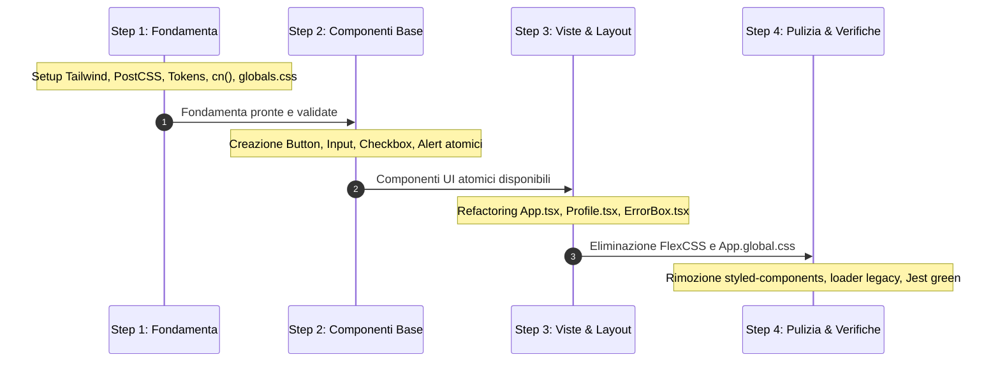

# Report di Gap Analysis: Standard di Styling UI ed Ergonomia Desktop (Fase 4.1 - DoD-01)

Documento di audit tecnico, censimento delle non-conformità e piano di remediation per l'architettura di presentazione, styling e usabilità desktop dell'applicazione `microsoft-teams-instances-manager`.

---

## 1. Obiettivo e Ambito dell'Assessment

### 1.1 Scopo Funzionale e Tecnico

L'obiettivo di questo assessment è formalizzare lo stato "As-Is" dello styling e dell'interfaccia utente nel processo Renderer di Electron (`src/`), evidenziando i limiti architetturali, prestazionali e di accessibilità derivanti dall'adozione legacy di librerie CSS-in-JS a runtime (`styled-components` v6) e fogli di stile globali non governati (`src/App.global.css`).

La valutazione traccia il perimetro per la transizione verso un'architettura **Zero-Runtime CSS** basata su **Tailwind CSS**, design token semantici, helper di aggregazione classi (`cn()`) e componenti visuali atomici orientati all'ergonomia di un'applicazione desktop Windows moderna (Electron 44 + React 19 + Next.js 16).

### 1.2 User Stories di Riferimento

- **Come sviluppatore**, voglio un sistema di styling zero-runtime e typesafe, affinché i bundle del renderer siano leggeri, privi di computazioni CSS dinamiche al montaggio e pienamente compatibili con React 19 e Next.js 16 Static Export.
- **Come utente finale**, voglio un'interfaccia reattiva conforme ai temi di sistema (Light/Dark mode) e con navigazione accessibile da tastiera, affinché la gestione dei profili Teams sia fluida, priva di artefatti visivi e integrata con l'ambiente desktop.

### 1.3 Criteri di Accettazione dell'Assessment (Gherkin)

- **Scenario 1: Censimento completo delle dipendenze**
  - _Dato_ il file di configurazione `package.json`,
  - _Quando_ viene eseguita l'analisi delle dipendenze di compilazione e runtime,
  - _Allora_ tutte le librerie di styling legacy e l'assenza degli strumenti target (Tailwind CSS, PostCSS, clsx, tailwind-merge) devono essere formalizzate con riferimenti precisi di riga.
- **Scenario 2: Tracciamento delle violazioni e pattern non conformi**
  - _Dato_ il codice sorgente del renderer sotto `src/`,
  - _Quando_ vengono ispezionati i componenti e i file CSS,
  - _Allora_ ogni occorrenza di reset distruttivo, colore hardcoded, elemento non semantico o computazione runtime deve essere censita con indicazione `file:line` e classe di severità.
- **Scenario 3: Definizione del piano di convergenza (DoD-01..DoD-06)**
  - _Dato_ l'inventario dei gap rilevati,
  - _Quando_ viene redatto il piano di remediation to-be,
  - _Allora_ la sequenza di migrazione deve essere articolata in 4 step tassativi collegati ai criteri della Definition of Done.

---

## 2. Censimento Dipendenze di Styling in `package.json`

L'analisi condotta sul manifesto di progetto `package.json` rivela una compresenza di librerie runtime e loader Webpack legacy che non rispecchiano la moderna pipeline di bundling Next.js 16 (`output: 'export'`):

| Pacchetto / Strumento                           | Sezione `package.json` | Versione Rilevata | Stato di Conformità           | Motivazione Architetturale e Impatto                                                                                                                                          |
| :---------------------------------------------- | :--------------------- | :---------------- | :---------------------------- | :---------------------------------------------------------------------------------------------------------------------------------------------------------------------------- |
| `styled-components`                             | _Rimosso_              | _Disinstallato_   | **RISOLTO** (Disinstallato)   | Rimosso con successo dalle dipendenze. Azzerato l'overhead di runtime CSS-in-JS e ripristinata piena compatibilità con l'architettura static export di Next.js 16 e React 19. |
| `sass-loader`                                   | _Rimosso_              | _Disinstallato_   | **RISOLTO** (Disinstallato)   | Preprocessore dismesso e rimosso dalla configurazione Webpack e dalle dipendenze di sviluppo.                                                                                 |
| `css-loader`                                    | `devDependencies:187`  | `^5.0.1`          | **RESIDUO WEBPACK** (Innocuo) | Mantenuto per compatibilità con il build del Main process Webpack; il renderer compila con PostCSS/Tailwind.                                                                  |
| `style-loader`                                  | _Rimosso_              | _Disinstallato_   | **RISOLTO** (Disinstallato)   | Iniezione dinamica a runtime rimossa a favore dell'estrazione statica del bundle CSS.                                                                                         |
| `mini-css-extract-plugin`                       | `devDependencies:204`  | `^1.3.1`          | **RESIDUO WEBPACK** (Innocuo) | Plugin Webpack per il build Electron Main; Next.js 16 gestisce l'estrazione CSS del renderer.                                                                                 |
| `@teamsupercell/typings-for-css-modules-loader` | `devDependencies:165`  | `^2.4.0`          | **RESIDUO WEBPACK** (Innocuo) | Tipizzazioni legacy Webpack.                                                                                                                                                  |
| `tailwindcss`                                   | `devDependencies:210`  | `^3.4.17`         | **CONFORME** (Installato)     | Fondamento dello standard To-Be per stili utility-first zero-runtime compilati a build-time.                                                                                  |
| `postcss`                                       | `devDependencies:206`  | `^8.4.49`         | **CONFORME** (Installato)     | Motore di trasformazione CSS indispensabile per il processing di Tailwind CSS e autoprefixer.                                                                                 |
| `autoprefixer`                                  | `devDependencies:178`  | `^10.4.20`        | **CONFORME** (Installato)     | Plugin PostCSS per la gestione dei vendor prefix CSS per il runtime Chromium di Electron.                                                                                     |
| `clsx`                                          | `dependencies:224`     | `^2.1.1`          | **CONFORME** (Installato)     | Utility minimale per la concatenazione condizionale typesafe delle classi CSS in `src/lib/utils.ts`.                                                                          |
| `tailwind-merge`                                | `dependencies:234`     | `^2.6.0`          | **CONFORME** (Installato)     | Risolutore di conflitti tra classi utility Tailwind impiegato nella funzione unificata `cn()`.                                                                                |

Configurazioni di styling attive alla radice del repository:

- Presenza di `tailwind.config.js` (`content: ['./src/**/*.{js,ts,jsx,tsx}']`).
- Presenza di `postcss.config.js` (`plugins: { tailwindcss: {}, autoprefixer: {} }`).

---

## 3. Inventario File e Pattern Non Conformi sotto `src/`

L'ispezione analitica dei sorgenti frontend evidenzia violazioni diffuse relative a reset globali distruttivi, stili hardcoded, elementi HTML non semantici e primitive di layout rigide.

```mermaid
flowchart TD
    subgraph NonConformities["Mappa delle Non-Conformità As-Is (src/)"]
        GlobalCSS["src/App.global.css"]
        FlexCSS["src/components/FlexCSS.tsx"]
        ButtonComp["src/components/Button.tsx"]
        ProfileComp["src/components/Profile.tsx"]
        ErrorBoxComp["src/components/ErrorBox.tsx"]
        AppView["src/App.tsx"]
    end

    GlobalCSS -->|Reset Distruttivo body *| R1["margin: 0.2rem indiscriminato"]
    GlobalCSS -->|Colore Hardcoded| R2["background: #1e53bd permanente"]
    GlobalCSS -->|Layout Rigido| R3["max-width: 90vw; font-family: sans-serif"]

    FlexCSS -->|Runtime CSS-in-JS| F1["styled.div per layout primitivi"]
    FlexCSS -->|Dimensionamento Errato| F2["width: 100vw; height: 100vh;"]

    ButtonComp -->|Antipattern Semantico| B1["styled.div come pulsante (no button nativo)"]
    ButtonComp -->|Colori e Ombre Fisse| B2["#3174c7, #3d78a0, #3558b2, #4b7fbf"]
    ButtonComp -->|Tipizzazione Debole| B3["Props.click: (T: void) => void"]

    ProfileComp -->|Props Deboli| P1["onRun: (T) => void; onDelete: (T) => void"]
    ProfileComp -->|Accoppiamento Forte| P2["Dipendenza da FlexCSS"]

    ErrorBoxComp -->|Colori Fissi| E1["background-color: tomato;"]
    ErrorBoxComp -->|A11y Assente| E2["Nessun role='alert' o aria-live"]

    AppView -->|Controlli Privi di Stile| A1["input text e checkbox non stilizzati"]
    AppView -->|Overflow Non Gestito| A2["Lista profili non scrollabile in finestra fissa"]
```



### 3.1 Dettaglio Violazioni `src/App.global.css`

Il foglio di stile globale caricato in `src/pages/_app.tsx:2` presenta regole ad alto impatto negativo:

1. **Reset Distruttivo Universale (`src/App.global.css:7-9`)**:
   ```css
   body * {
     margin: 0.2rem;
   }
   ```
   _Impatto_: La regola applica un margine non controllato a _qualsiasi_ elemento discendente nel DOM, impedendo l'allineamento preciso dei componenti atomici, rompendo il collasso dei margini standard e creando interferenze con componenti di terze parti o utility classes.
2. **Layout Rigido e Viewport Unfit (`src/App.global.css:11-23`)**:
   - `max-width: 90vw; margin: 0 auto;` (linee 14-15): forza una centratura basata su percentuali di viewport, inadatta a finestre desktop Electron con dimensioni fisse (`width: 400px, height: 500px` definite in `src/main.dev.ts:78-98`).
   - `font-family: sans-serif;` (linea 17): font generico che non sfrutta lo stack tipografico nativo di Windows (`Segoe UI`, `system-ui`).
   - `display: flex; flex-flow: column nowrap; align-items: center;` (linee 19-21): impone una struttura flexbox globale sul body che entra in conflitto con il container radice Next.js (`#__next`).
3. **Background e Colore Hardcoded (`src/App.global.css:16, 25`)**:
   - `color: white;` (linea 16) e `background: #1e53bd;` (linea 25): forzano una palette fissa blu/bianco, impedendo il supporto dinamico ai temi chiaro/scuro e provocando affaticamento visivo.

### 3.2 Dettaglio Violazioni `src/components/FlexCSS.tsx`

Modulo dedicato all'esportazione di componenti `styled.div` a runtime (`src/components/FlexCSS.tsx:1-50`):

- `Root` (`linee 3-11`): dichiara `width: 100vw; height: 100vh;`, generando potenziali barre di scorrimento orizzontali e verticali all'interno della finestra fissa di Electron.
- `FlexItem` (`linee 13-19`): impone `margin: 2px 4px;` hardcoded, sovrapponendosi ulteriormente al `margin: 0.2rem` globale.
- `FlexBottomItem` (`linee 21-30`): accumula direttive ridondanti (`align-self`, `place-self`, `justify-self: flex-end`) per compensare la mancanza di una griglia o flexbox coerente.
- `Row` (`linee 32-38`): wrapper flex orizzontale con spaziatura rigida `justify-content: space-around;`.
- `LeftFlexTextCSS` (`linee 40-48`): estensione con `overflow: hidden; text-overflow: ellipsis; white-space: nowrap;`. Funzionalità necessaria per i nomi dei profili ma implementata come componente CSS-in-JS isolato invece di utility standard (`truncate`).

### 3.3 Dettaglio Violazioni `src/components/Button.tsx`

Il pulsante primario dell'applicazione evidenzia criticità severe sia visive che di accessibilità (`src/components/Button.tsx:1-41`):

1. **Violazione Semantica e di Accessibilità (`linea 3, 36`)**:
   ```typescript
   const ButtonCSS = styled.div`...`;
   // ...
   <ButtonCSS onClick={() => click()}>{text}</ButtonCSS>;
   ```
   Il componente renderizza un elemento `<div>` generico invece di un tag HTML `<button>`. Ciò impedisce la navigazione sequenziale tramite `Tab`, la ricezione dello stato di focus da tastiera e l'attivazione nativa con i tasti `Invio` o `Spazio`.
2. **Colori, Gradienti Fittizi e Font Hardcoded (`linee 4-19`)**:
   - `box-shadow: inset 0px 39px 0px -24px #3d78a0;` (`linea 4`): gradiente artificiale rigido.
   - `background-color: #3174c7;` (`linea 5`): colore di background primario hardcoded.
   - `border: 1px solid #ffffff;` (`linea 7`) e `color: #ffffff;` (`linea 10`): contrasto non verificabile su temi chiari.
   - `font-family: Arial; font-size: 15px;` (`linee 11-12`): font e dimensione in pixel fissi.
   - `text-shadow: 0px 1px 0px #3558b2;` (`linea 15`).
   - `&:hover { background-color: #4b7fbf; }` (`linee 17-19`): colore hover hardcoded.
   - `&:active { position: relative; top: 1px; }` (`linee 21-24`): pseudo-animazione imperativa tramite posizionamento relativo.
3. **Mancanza di Stati Interattivi e Accessibilità**:
   - Assenza totale di `:focus-visible` o anello di focus (`ring`).
   - Assenza di supporto allo stato `disabled` (visivo e comportamentale).
   - Tipizzazione non standard del callback `click: (T: void) => void` (`linea 29`).

### 3.4 Dettaglio Violazioni `src/components/Profile.tsx`

Rappresenta la riga di visualizzazione e gestione del singolo profilo Teams (`src/components/Profile.tsx:1-37`):

- `ProfileCSS` (`linee 5-9`): `max-width: 80vw; display: flex; flex-flow: row nowrap;`. Limita artificialmente la larghezza in base al viewport (`80vw`), generando spaziature disallineate rispetto ai controlli di configurazione superiori.
- Mancanza di una card visiva, separatori o bordi tra i profili censiti.
- Dipendenza diretta da `FlexCSS.tsx` (`LeftFlexTextCSS`, `FlexItem`, `linea 3`).
- Tipizzazione regressiva dei callback: `onRun: (T) => void; onDelete: (T) => void;` (`linee 13-14`), dove `T` non è un generico parametrico ma viene interpretato implicitamente come `any`.

### 3.5 Dettaglio Violazioni `src/components/ErrorBox.tsx`

Banner per la segnalazione visiva dei messaggi di errore IPC (`src/components/ErrorBox.tsx:1-25`):

- `ErrorBoxCSS` (`linee 3-14`):
  - `position: fixed; top: 0; left: 0; width: 100%; height: 2.5rem;` (`linee 4-6, 12-13`): barra fissa a schermo intero posizionata in cima alla finestra, che copre i controlli sottostanti senza transizione di ingresso/uscita.
  - `background-color: tomato; color: white;` (`linee 10-11`): utilizzo di colore nominato CSS (`tomato` = `#ff6347`) anziché un design token semantico di errore/distruzione (`--destructive`).
  - Assenza di attributi ARIA (`role="alert"`, `aria-live="assertive"`) necessari agli screen reader per notificare l'errore asincrono.
  - Assenza di un meccanismo di chiusura manuale (pulsante di dismiss); dipende esclusivamente da un `setTimeout` arbitrario di 5000ms configurato nel genitore (`src/App.tsx:17`).

### 3.6 Censimento Puntuale dei Colori Hardcoded

| Valore Colore Rilevato | File e Riga di Definizione       | Componente / Elemento Coinvolto   | Ruolo Semantico Proposto (Design Token To-Be)           |
| :--------------------- | :------------------------------- | :-------------------------------- | :------------------------------------------------------ |
| `#1e53bd`              | `src/App.global.css:25`          | `body` (background globale)       | `hsl(var(--background))` / `hsl(var(--primary))`        |
| `white` / `#ffffff`    | `src/App.global.css:16`          | `body` (testo globale)            | `hsl(var(--foreground))`                                |
| `#ffffff`              | `src/components/Button.tsx:7`    | `ButtonCSS` (bordo)               | `hsl(var(--primary-foreground))` / `hsl(var(--border))` |
| `#ffffff`              | `src/components/Button.tsx:10`   | `ButtonCSS` (testo)               | `hsl(var(--primary-foreground))`                        |
| `white`                | `src/components/ErrorBox.tsx:11` | `ErrorBoxCSS` (testo errore)      | `hsl(var(--destructive-foreground))`                    |
| `#3174c7`              | `src/components/Button.tsx:5`    | `ButtonCSS` (background base)     | `hsl(var(--primary))`                                   |
| `#4b7fbf`              | `src/components/Button.tsx:18`   | `ButtonCSS` (hover state)         | `hsl(var(--primary-hover))`                             |
| `#3d78a0`              | `src/components/Button.tsx:4`    | `ButtonCSS` (inset box-shadow)    | Rimozione ombra hardcoded; uso di `shadow-sm`           |
| `#3558b2`              | `src/components/Button.tsx:15`   | `ButtonCSS` (text-shadow)         | Rimozione ombra testo; contrasto tipografico netto      |
| `tomato` (`#ff6347`)   | `src/components/ErrorBox.tsx:10` | `ErrorBoxCSS` (background banner) | `hsl(var(--destructive))`                               |

---

## 4. Analisi di Impatto e Priorità di Migrazione

I gap identificati sono stati classificati in tre livelli di priorità in base al rischio architetturale, all'impatto sull'accessibilità e alla complessità esecutiva:

| ID Gap           | Priorità           | Descrizione del Gap                                                                                                                             | File Coinvolti                                                                         | Complessità | Strategia Tecnica di Risoluzione                                                                                                 |
| :--------------- | :----------------- | :---------------------------------------------------------------------------------------------------------------------------------------------- | :------------------------------------------------------------------------------------- | :---------- | :------------------------------------------------------------------------------------------------------------------------------- |
| **GAP-STYLE-01** | **P1 (Bloccante)** | Presenza di `styled-components` v6 (runtime CSS-in-JS). Incompatibilità con Next.js 16 static export, overhead prestazionale, inquinamento DOM. | `package.json:220`, `FlexCSS.tsx:1`, `Button.tsx:1`, `Profile.tsx:1`, `ErrorBox.tsx:1` | Media       | Disinstallazione del pacchetto, migrazione delle regole a utility classes Tailwind CSS native.                                   |
| **GAP-STYLE-02** | **P1 (Bloccante)** | Reset globale invasivo `body * { margin: 0.2rem; }` e background hardcoded `#1e53bd`.                                                           | `src/App.global.css:7-25`, `src/pages/_app.tsx:2`                                      | Bassa       | Eliminazione di `App.global.css`. Introduzione di `src/styles/globals.css` con direttive standard `@tailwind` e reset moderno.   |
| **GAP-STYLE-03** | **P1 (Bloccante)** | Pulsante `Button.tsx` implementato come `<div>` anziché `<button>`, assenza di navigabilità da tastiera, assenza di `:focus-visible`.           | `src/components/Button.tsx:3, 36`                                                      | Bassa       | Riscrittura semantica con tag `<button>`, focus-visible ring, gestione varianti con Tailwind CSS.                                |
| **GAP-STYLE-04** | **P2 (Alta)**      | Assenza del sistema di Design Tokens (CSS Variables) e del supporto ai temi Light/Dark nativi del sistema operativo.                            | `src/App.global.css`, tutti i componenti in `src/components/`                          | Media       | Definizione di token HSL semantici in `:root` e `.dark` all'interno di `src/styles/globals.css` mappati in `tailwind.config.ts`. |
| **GAP-STYLE-05** | **P2 (Alta)**      | Mancanza dell'utility `cn()` e delle librerie `clsx` e `tailwind-merge` per l'aggregazione sicura delle classi CSS.                             | `package.json`, assenza di `src/lib/utils.ts`                                          | Bassa       | Installazione di `clsx` e `tailwind-merge`. Creazione del modulo `src/lib/utils.ts` con helper `cn()`.                           |
| **GAP-STYLE-06** | **P2 (Alta)**      | Mancanza di componenti UI atomici riutilizzabili (`src/components/ui/`) e controlli form (`input`, `checkbox`) privi di stile uniforme.         | `src/App.tsx:155-181`, `src/components/`                                               | Media       | Implementazione di componenti UI atomici in `src/components/ui/` (`button.tsx`, `input.tsx`, `checkbox.tsx`, `alert.tsx`).       |
| **GAP-STYLE-07** | **P3 (Media)**     | Mancanza di regole di ergonomia desktop Electron (selezione testo non bloccata, scrollbars non stilizzate, layout profili non scrollabile).     | `src/App.global.css`, `src/App.tsx:185-193`, `src/main.dev.ts:78-98`                   | Media       | Regole globali `user-select: none` con deroga su campi input, styling scrollbar, contenitore profili con `overflow-y-auto`.      |
| **GAP-STYLE-08** | **P3 (Media)**     | Presenza di loader Webpack legacy e non utilizzati (`sass-loader`, `style-loader`, `css-loader`).                                               | `package.json:155, 173, 195, 196`                                                      | Bassa       | Rimozione delle dipendenze obsolete da `devDependencies` in `package.json`.                                                      |

---

## 5. Verifica Ergonomia Desktop Electron

Lo sviluppo di applicazioni desktop su runtime Electron impone vincoli ergonomici e interattivi distinti rispetto ai siti web tradizionali. L'ispezione della codebase ha rilevato cinque criticità ergonomiche:

### 5.1 Prevenzione della Selezione Testuale Involontaria (`user-select`)

- **Stato As-Is**: `src/App.global.css` non impone alcuna limitazione sulla selezione. L'utente, effettuando un doppio clic rapido o trascinando il cursore su pulsanti, etichette o righe di profilo, seleziona il testo blu/bianco evidenziandolo come in una pagina web non formattata.
- **Requisito Target (`REQ-EL-01`)**: L'intera shell applicativa deve applicare `user-select: none;` (`-webkit-user-select: none;`). Soltanto i campi di immissione testo (`input[type="text"]`) ed eventuali contenitori di log o codici esplicitamente destinati al copia-incolla devono consentire `user-select: text;`.

### 5.2 Regioni di Trascinamento della Finestra (Window Drag Regions)

- **Stato As-Is**: `src/main.dev.ts:88-112` istanzia `BrowserWindow` con decorazioni native del sistema operativo standard (finestra con barra del titolo Windows nativa, controlli Riduci a icona / Chiudi standard). Non sono presenti classi CSS `-webkit-app-region: drag` né `-webkit-app-region: no-drag`.
- **Requisito Target**: Nel layout con finestra standard nativa, gli elementi interattivi non devono soffrire di interferenze con la barra di sistema; qualora venisse introdotta una barra del titolo personalizzata, le aree non cliccabili dovranno implementare la classe `drag` e tutti i pulsanti/input la classe `no-drag`.

### 5.3 Supporto Dinamico ai Temi Light e Dark di Sistema

- **Stato As-Is**: La palette cromatica è bloccata sul blu saturo `#1e53bd` e testo `white` (`src/App.global.css:16, 25`). L'applicazione ignora completamente le preferenze dell'utente impostate in Windows (Impostazioni di sistema -> Personalizzazione -> Colori -> Scegli la modalità: Chiaro/Scuro).
- **Requisito Target (`REQ-EL-03`)**: Integrazione della media query standard `@media (prefers-color-scheme: dark)` accoppiata alle CSS variables semantiche (`:root` per Light Mode, `.dark` o media query per Dark Mode). L'interfaccia deve adattare istantaneamente sfondo, testi, bordi e stati di hover all'alternanza del tema di sistema.

### 5.4 Accessibilità da Tastiera e Segnalazione del Focus

- **Stato As-Is**:
  - `src/components/Button.tsx:3` è un `div` non focalizzabile tramite sequenza `Tab`.
  - `src/App.tsx:155-181` contiene elementi `<input type="checkbox">` e `<input type="text">` che ereditano lo stile nativo del browser, privi di indicatori di focus ad alto contrasto.
- **Requisito Target (`REQ-EL-02`)**: Tutti gli elementi azionabili devono essere tag semantici (`<button>`, `<input>`) dotati di anello di focus visibile ed evidente (`focus-visible:ring-2 focus-visible:ring-primary focus-visible:outline-none`) conforme alle linee guida WCAG 2.1 AA.

### 5.5 Gestione dell'Overflow e Scrollbars Desktop

- **Stato As-Is**:
  - `src/main.dev.ts:78-98` vincola la finestra in produzione a una dimensione fissa e non ridimensionabile di `400px` di larghezza per `500px` di altezza (`minWidth: 400, maxWidth: 400, minHeight: 500, maxHeight: 500`).
  - `src/App.global.css:18` dichiara `overflow-x: hidden;`, ma non disciplina l'overflow verticale.
  - In `src/App.tsx:185-193`, la lista dei profili viene mappata linearmente all'interno di un contenitore non vincolato. Se l'utente registra più di 4-5 profili, l'interfaccia supera l'altezza di 500px, provocando l'uscita degli elementi dal viewport o l'innesco di una scrollbar nativa Chromium disallineata.
- **Requisito Target (`REQ-EL-04`)**: Il layout principale deve adottare un'altezza fissa al 100% della finestra (`h-screen flex flex-col`), confinando la lista dei profili all'interno di una sezione scrollabile dedicata (`flex-1 overflow-y-auto`) con scrollbar personalizzata sottile e discreta conforme allo stile Fluent/Windows 11.

---

## 6. Piano di Remediation To-Be e Mappatura DoD (DoD-01..DoD-06)

Il piano di remediation per la Fase 4.2 si articola in quattro step operativi sequenziali e tassativi. L'avanzamento tra i passaggi è subordinato al superamento dei test e della verifica statica.



### 6.1 Dettaglio dei 4 Step Operativi Tassativi

#### Step 1: Fondamenta (Setup & Configuration)

1. **Installazione Pacchetti**:
   - Dipendenze di sviluppo: `tailwindcss`, `postcss`, `autoprefixer`.
   - Dipendenze di produzione: `clsx`, `tailwind-merge`.
2. **Configurazione Tailwind e PostCSS**:
   - Creazione di `tailwind.config.ts` con inclusione dei percorsi di content:
     `content: ['./src/**/*.{js,ts,jsx,tsx}']`.
   - Configurazione di `darkMode: ['class', '[data-theme="dark"]']` (o basato su media query).
   - Mappatura dei colori semantici su variabili CSS HSL (`background`, `foreground`, `primary`, `destructive`, `muted`, `accent`, `border`, `input`, `ring`).
   - Creazione di `postcss.config.mjs` con plugin `tailwindcss` e `autoprefixer`.
3. **Helper di aggregazione classi (`cn`)**:

   - Creazione del modulo `src/lib/utils.ts`:

     ```typescript
     import { clsx, type ClassValue } from 'clsx';
     import { twMerge } from 'tailwind-merge';

     export function cn(...inputs: ClassValue[]): string {
       return twMerge(clsx(inputs));
     }
     ```

4. **Foglio di Stile Globale Unificato**:
   - Creazione di `src/styles/globals.css`:
     - Iniezione direttive `@tailwind base; @tailwind components; @tailwind utilities;`.
     - Definizione del blocco `:root` (Light Mode) e `.dark` (Dark Mode) per i design token semantici.
     - Implementazione delle regole di ergonomia desktop: `user-select: none`, `input { user-select: text; }`, styling personalizzato delle scrollbars.
5. **Switch dell'Import Globale**:
   - Aggiornamento di `src/pages/_app.tsx` per importare `../styles/globals.css` in sostituzione di `../App.global.css`.

#### Step 2: Componenti Base (Atomic UI Components)

Creazione della directory `src/components/ui/` contenente componenti accessibili e riutilizzabili:

1. `src/components/ui/button.tsx`:
   - Implementato tramite tag semantico `<button>`.
   - Supporto per varianti (`default`, `destructive`, `outline`, `secondary`, `ghost`) e dimensioni (`default`, `sm`, `lg`).
   - Inclusione degli stati `focus-visible:ring-2`, `disabled:opacity-50`, transizioni fluide di background.
2. `src/components/ui/input.tsx`:
   - Elemento `<input type="text">` stilizzato con bordi semantici, focus ring uniforme e padding coerente.
3. `src/components/ui/checkbox.tsx`:
   - Checkbox accessibile con label associata, stato `:checked` a contrasto elevato e focus ring.
4. `src/components/ui/alert.tsx`:
   - Banner semantico per messaggi informativi e di errore (`role="alert"`, `aria-live="assertive"`), con variante `destructive` e iconografia discreta.

#### Step 3: Viste e Layout (View Migration)

1. **Refactoring di `src/components/Profile.tsx`**:
   - Rimozione di `styled-components` e delle dipendenze da `FlexCSS.tsx`.
   - Adozione di un container a card (`flex items-center justify-between p-2 rounded border bg-card text-card-foreground`).
   - Titolo del profilo gestito con utility Tailwind `truncate font-medium`.
   - Pulsanti "run" e "delete" sostituiti con `<Button size="sm">` e `<Button variant="destructive" size="sm">`.
   - Tipizzazione corretta e rigorosa delle props (`onRun: (name: string) => void`, `onDelete: (name: string) => void`).
2. **Refactoring di `src/components/ErrorBox.tsx`**:
   - Sostituzione del `div` fisso a tutta larghezza con l'Alert semantico (`src/components/ui/alert.tsx`).
3. **Refactoring della Vista Principale `src/App.tsx`**:
   - Strutturazione del layout principale:
     - Header fisso (`p-4 border-b`) con opzioni di avvio automatico (checkbox stilizzate).
     - Sezione di inserimento nuovo profilo (`flex gap-2 p-4`).
     - Lista profili confinata in un contenitore scrollabile (`flex-1 overflow-y-auto p-4 space-y-2`).
   - Eliminazione completa dell'import di `Row` da `FlexCSS.tsx`.
4. **Dismissione di `src/components/FlexCSS.tsx`**:
   - Eliminazione del file una volta azzerate le dipendenze in tutti i componenti.

#### Step 4: Pulizia Finale e Rimozione Dipendenze

1. **Disinstallazione Pacchetti Obsoleti**:
   - Rimozione di `styled-components` e dei relativi typings da `package.json`.
   - Rimozione di `sass-loader`, `style-loader`, `css-loader` non utilizzati.
2. **Eliminazione File Residui**:
   - Rimozione definitiva di `src/App.global.css`.
3. **Verifica e Test di Regressione**:
   - Adeguamento dei test unitari in `src/__tests__/App.test.tsx` per verificare la presenza delle nuove classi accessibili e l'interazione con tag `<button>`.
   - Esecuzione completa di test Jest (`yarn test`), linting (`npm run lint`), build Next.js (`yarn build:renderer`) e build Electron (`yarn build:main`).

---

### 6.2 Mappatura dei Criteri di Accettazione (DoD-01..DoD-06)

| ID Criterio | Titolo del Criterio di Accettazione                     | Risultato Atteso                                                                                                                                                                                    | Stato di Riferimento               |
| :---------- | :------------------------------------------------------ | :-------------------------------------------------------------------------------------------------------------------------------------------------------------------------------------------------- | :--------------------------------- |
| **DoD-01**  | **Report di Gap Analysis e Standard di Styling**        | Documentazione formale dell'audit As-Is (`gap-analysis-ui-styling.md`) e integrazione dello standard di styling in `coding-standards.md`.                                                           | **COMPLETATO** (Fase 4.1)          |
| **DoD-02**  | **Setup Infrastrutturale Tailwind CSS e Design Tokens** | Installazione di `tailwindcss`, `postcss`, `autoprefixer`, configurazione `tailwind.config.js`, `src/lib/utils.ts` (`cn`), `src/styles/globals.css` con token CSS semantici e switch in `_app.tsx`. | **COMPLETATO** (Fase 4.2 - Step 1) |
| **DoD-03**  | **Libreria Componenti Atomici Accessibili**             | Creazione di `Button`, `Input`, `Checkbox`, `Alert` in `src/components/ui/` (`index.ts`) conformi a WCAG 2.1 AA e supporto completo navigazione da tastiera.                                        | **COMPLETATO** (Fase 4.2 - Step 2) |
| **DoD-04**  | **Migrazione delle Viste e Layout Desktop**             | Refactoring di `App.tsx`, `Profile.tsx`, `ErrorBox.tsx`, layout scrollabile profili, eliminazione definitiva di `src/components/FlexCSS.tsx` e `src/App.global.css`.                                | **COMPLETATO** (Fase 4.2 - Step 3) |
| **DoD-05**  | **Dismissione styled-components e Pulizia Dipendenze**  | Rimozione di `styled-components`, dismissione di `src/App.global.css`, pulizia loader obsoleti in `package.json`.                                                                                   | Pianificato (Fase 4.2 - Step 4)    |
| **DoD-06**  | **Verifica di Regressione e Conformità Qualitativa**    | 100% test Jest green, zero errori di linting ESLint 9 Flat Config, zero errori di compilazione TypeScript e build Next.js/Electron riuscite.                                                        | Pianificato (Fase 4.2 - Step 4)    |
