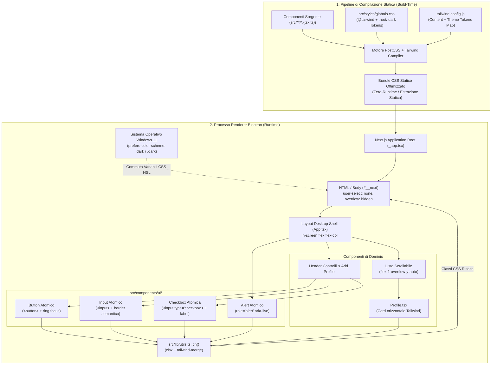
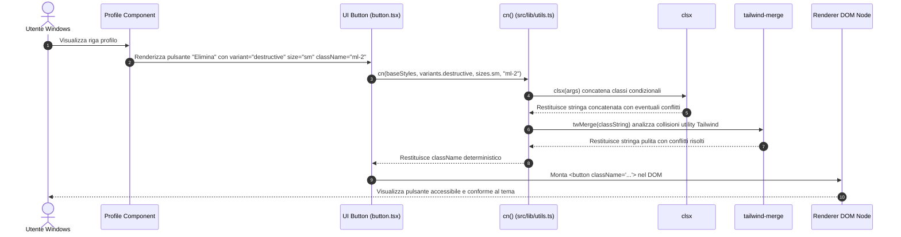

# Standard di Styling UI ed Ergonomia Desktop (Fase 4.1 - DoD-01)

Documento formale e vincolante degli standard architetturali di styling, presentazione visiva, accessibilità ed ergonomia desktop per il Renderer Process di `microsoft-teams-instances-manager` (Next.js 16.4.6 + React 19.3.1 + Electron 44.11.5).

---

## 1. Obiettivo e Principi Guida

L'architettura di presentazione grafica dell'applicazione abbandona le soluzioni eterogenee e a runtime legacy (`styled-components` v6, `src/App.global.css`) per adottare un paradigma unificato, reattivo e typesafe conforme a quattro principi fondamentali:

### 1.1 Zero-Runtime CSS e Compilazione Statica

- **Nessuna Iniezione Dinamica**: Nessun foglio di stile, blocco `<style>` o regola CSS può essere calcolato, serializzato o iniettato nel DOM dal thread principale JavaScript di React durante l'esecuzione dell'interfaccia utente.
- **Compilazione Statica a Build-Time**: Tutte le classi visuali sono generate e ottimizzate a monte durante la fase di compilazione di Next.js (`output: 'export'`) tramite il motore di **Tailwind CSS** e **PostCSS**.
- **Riduzione dell'Overhead**: Azzeramento del tempo di CPU speso da React per l'hash e la risoluzione dei selettori CSS-in-JS al montaggio dei componenti, eliminando i cali di framerate nel processo Renderer di Electron.

### 1.2 Prestazioni e Dimensionamento del Bundle

- **Purging Determinista**: Il compilatore Tailwind analizza staticamente tutti i file sorgente (`./src/**/*.{js,ts,jsx,tsx}`) ed include nel bundle finale esclusivamente le classi effettivamente dichiarate, producendo un foglio di stile compatto e altamente cacheabile.
- **Eliminazione di Dipendenze Pesanti**: Rimozione della libreria `styled-components` (`package.json:224`) e dei loader Webpack legacy non utilizzati (`sass-loader`, `style-loader`, `css-loader`), riducendo la complessità della supply-chain e la dimensione degli artefatti distribuiti.

### 1.3 Accessibilità e Conformità WCAG 2.1 AA

- **Semantica HTML Nativa**: È categoricamente vietato simulare controlli interattivi con tag non semantici (es. `<div>` o `<span>` con handler `onClick`). Tutti i controlli azionabili devono utilizzare elementi standard (`<button>`, `<input type="checkbox">`, `<input type="text">`).
- **Navigazione da Tastiera Completa**: L'intera interfaccia deve essere esplorabile e azionabile tramite sequenza logica di `Tab`, `Shift+Tab`, `Invio` e `Spazio`.
- **Focus Ring ad Alto Contrasto**: Ogni elemento attivo deve mostrare un anello di focus visibile ed inequivocabile nello stato `:focus-visible`, privo di ambiguità visiva sia su tema chiaro che scuro.
- **Rapporti di Contrasto Verificati**: Tutti i token cromatici per testo (`foreground`, `primary-foreground`, `destructive-foreground`) rispetto ai rispettivi sfondi (`background`, `card`, `primary`, `destructive`) devono rispettare rigorosamente la soglia minima di contrasto 4.5:1 (WCAG 2.1 Livello AA).

### 1.4 Coerenza Visiva ed Ergonomia Desktop (Windows 11 Fluent)

- **Design System Coeso**: Spaziature, raggi di curvatura (`border-radius`), ombre e palette cromatica sono governati centralmente da token semantici, escludendo qualsiasi valore arbitrario non documentato.
- **Look-and-Feel Desktop**: L'interfaccia deve presentarsi come una nativa applicazione Windows 11, integrando scrollbar discrete, prevenzione della selezione testuale non necessaria, rispetto delle dimensioni fisse della finestra e sincronizzazione immediata con il tema di sistema.

---

## 2. Standard Architetturale Target

### 2.1 REQ-ST-01: Motore Utility-First Zero-Runtime & Helper di Composizione `cn()`

1. **Adozione di Tailwind CSS**:
   Il sistema di styling adotta **Tailwind CSS v3.4+** come unico framework per la composizione delle classi di presentazione. Le utility class devono esprimere layout (flexbox, grid), posizionamento, tipografia, bordi, transizioni e stati interattivi (`hover:`, `active:`, `focus-visible:`, `disabled:`).

2. **Composizione Condizionale Obbligatoria con `cn()` (`src/lib/utils.ts`)**:
   Tutti i componenti React del progetto devono aggregare le classi CSS e consentire l'override delle proprietà stilistiche da parte dei componenti consumatori utilizzando esclusivamente la funzione di utilità centralizzata `cn()`, formalizzata in `src/lib/utils.ts:1-6`:

   ```typescript
   // src/lib/utils.ts
   import { clsx, type ClassValue } from 'clsx';
   import { twMerge } from 'tailwind-merge';

   export function cn(...inputs: ClassValue[]): string {
     return twMerge(clsx(inputs));
   }
   ```

   - **`clsx` (`package.json:224`)**: Gestisce la concatenazione typesafe di argomenti condizionali, espressioni booleane, array e oggetti chiave-valore (`cn('base', isActive && 'active', className)`).
   - **`tailwind-merge` (`package.json:234`)**: Risolve in modo deterministico i conflitti di specificità CSS tipici delle utility class Tailwind. Quando una classe sovrascrive una precedente (es. `p-2` di base sostituito da `p-4` passato via `className`), `tailwind-merge` preserva solo l'ultima istanza, garantendo l'assenza di comportamenti imprevisti di cascade.

3. **Pattern di Utilizzo Standard nei Componenti**:
   Ogni componente riutilizzabile o molecolare deve esporre la prop opzionale `className?: string` e fonderla con le classi di base tramite `cn()`:

   ```typescript
   export interface ComponentProps
     extends React.HTMLAttributes<HTMLDivElement> {
     variant?: 'default' | 'muted';
   }

   export function Card({
     className,
     variant = 'default',
     ...props
   }: ComponentProps) {
     return (
       <div
         className={cn(
           'rounded-md border p-4 bg-card text-card-foreground shadow-sm',
           variant === 'muted' && 'bg-muted text-muted-foreground',
           className
         )}
         {...props}
       />
     );
   }
   ```

---

### 2.2 REQ-ST-02: Design Tokens Semantici e Supporto Temi (Light/Dark Mode)

1. **Definizione dei Design Tokens su Variabili CSS HSL**:
   I valori di colore, sfondo, bordi e anelli di focus sono formalizzati come variabili CSS native all'interno di `src/styles/globals.css:6-38`. Le variabili memorizzano triplette cromatiche nello spazio HSL (`Hue Saturation% Lightness%`), prive della funzione `hsl()`, consentendo a Tailwind di iniettare dinamicamente il modificatore di opacità:

   ```css
   /* src/styles/globals.css:5-39 */
   @layer base {
     :root {
       --background: 220 20% 97%;
       --foreground: 220 25% 10%;
       --card: 0 0% 100%;
       --card-foreground: 220 25% 10%;
       --primary: 217 91% 50%;
       --primary-foreground: 0 0% 100%;
       --primary-hover: 217 91% 45%;
       --destructive: 0 84% 60%;
       --destructive-foreground: 0 0% 100%;
       --muted: 220 15% 90%;
       --muted-foreground: 220 10% 40%;
       --border: 220 15% 85%;
       --input: 220 15% 85%;
       --ring: 217 91% 50%;
     }

     .dark {
       --background: 222 47% 11%;
       --foreground: 210 40% 98%;
       --card: 222 47% 14%;
       --card-foreground: 210 40% 98%;
       --primary: 217 91% 60%;
       --primary-foreground: 222 47% 11%;
       --primary-hover: 217 91% 55%;
       --destructive: 0 72% 51%;
       --destructive-foreground: 210 40% 98%;
       --muted: 217 33% 20%;
       --muted-foreground: 215 20% 65%;
       --border: 217 33% 22%;
       --input: 217 33% 22%;
       --ring: 217 91% 60%;
     }
   }
   ```

2. **Mappatura Rigorosa in `tailwind.config.js`**:
   Tutti i token sono registrati nella configurazione di Tailwind (`tailwind.config.js:7-31`), mappando ciascun alias semantico sulla relativa variabile CSS:

   ```javascript
   // tailwind.config.js
   module.exports = {
     darkMode: ['class'],
     content: ['./src/**/*.{js,ts,jsx,tsx}'],
     theme: {
       extend: {
         colors: {
           background: 'hsl(var(--background))',
           foreground: 'hsl(var(--foreground))',
           card: {
             DEFAULT: 'hsl(var(--card))',
             foreground: 'hsl(var(--card-foreground))',
           },
           primary: {
             DEFAULT: 'hsl(var(--primary))',
             foreground: 'hsl(var(--primary-foreground))',
             hover: 'hsl(var(--primary-hover))',
           },
           destructive: {
             DEFAULT: 'hsl(var(--destructive))',
             foreground: 'hsl(var(--destructive-foreground))',
           },
           muted: {
             DEFAULT: 'hsl(var(--muted))',
             foreground: 'hsl(var(--muted-foreground))',
           },
           border: 'hsl(var(--border))',
           input: 'hsl(var(--input))',
           ring: 'hsl(var(--ring))',
         },
       },
     },
     plugins: [],
   };
   ```

3. **Divieto Categorico di Colori Hardcoded**:

   - È severamente vietato introdurre valori esadecimali (`#1e53bd`, `#ffffff`, `#3174c7`), funzioni `rgb()`/`rgba()`, nomi di colori CSS standard (`tomato`, `blue`, `white`) o classi arbitrarie Tailwind fisse (es. `bg-[#1e53bd]`).
   - Qualsiasi sfumatura o colore funzionale deve fare capo a un token semantico (`bg-background`, `text-foreground`, `bg-primary`, `text-destructive`).

4. **Supporto Light/Dark Mode Dinamico Zero-Re-render**:
   - Il passaggio tra Light e Dark mode opera a livello di CSS nativo commutando la classe `.dark` sull'elemento radice `<html>` o `<body>` (oppure tramite la media query `@media (prefers-color-scheme: dark)`).
   - La commutazione aggiorna istantaneamente i valori delle variabili CSS senza innescare re-render nell'albero dei componenti React, prevenendo flickering, stuttering o ricalcoli di layout nel Renderer di Electron.

---

### 2.3 REQ-ST-03: Componenti UI Atomici e Primitivi Accessibili in `src/components/ui/`

La cartella `src/components/ui/` costituisce il design system atomico e headless dell'applicazione. I componenti devono essere puri, accessibili, disaccoppiati dalla logica di business e manutenibili singolarmente:

#### 1. Pulsante Atomico (`src/components/ui/button.tsx`)

- **Tag Nativo**: Tag semantico `<button>` (sostituisce definitivamente il non conforme `styled.div` di `src/components/Button.tsx:3, 36`).
- **Supporto Varianti**:
  - `default`: sfondo `bg-primary text-primary-foreground hover:bg-primary/90`.
  - `destructive`: sfondo `bg-destructive text-destructive-foreground hover:bg-destructive/90`.
  - `outline`: bordo `border border-input bg-background hover:bg-muted hover:text-foreground`.
  - `secondary`: sfondo `bg-muted text-foreground hover:bg-muted/80`.
  - `ghost`: sfondo trasparente `hover:bg-muted hover:text-foreground`.
- **Dimensioni**: `default` (`h-9 px-4 py-2 text-sm`), `sm` (`h-8 px-3 text-xs`), `lg` (`h-10 px-8 text-base`).
- **Stati Interattivi**: `:focus-visible` con ring prominente, stato `disabled:pointer-events-none disabled:opacity-50`, transizioni cromatiche fluide `transition-colors`.
- **Tipizzazione**: Estensione diretta di `React.ButtonHTMLAttributes<HTMLButtonElement>`.

#### 2. Campo di Input Testuale (`src/components/ui/input.tsx`)

- **Tag Nativo**: Tag `<input type="text">` conforme.
- **Stile Visivo**: Bordo semantico `border border-input`, sfondo `bg-background`, testo `text-foreground`, placeholder `placeholder:text-muted-foreground`.
- **Focus & Disabilitazione**: Indicatore `focus-visible:outline-none focus-visible:ring-2 focus-visible:ring-ring`, stato `disabled:cursor-not-allowed disabled:opacity-50`.
- **Tipizzazione**: Estensione di `React.InputHTMLAttributes<HTMLInputElement>`.

#### 3. Controllo Checkbox (`src/components/ui/checkbox.tsx`)

- **Elemento Semantico**: Tag `<input type="checkbox">` o primitivo headless accessibile con label associata (`<label htmlFor="...">`).
- **Accessibilità**: Associazione biunivoca con l'identificatore del testo descrittivo, focus ring visibile su navigazione tastiera, contrasto netto nello stato selezionato (`accent-primary` o svg checkmark su sfondo `primary`).
- **Tipizzazione**: Estensione di `React.InputHTMLAttributes<HTMLInputElement>`.

#### 4. Banner di Notifica e Allerta (`src/components/ui/alert.tsx`)

- **Ruolo Semantico ARIA**: Elemento con `role="alert"` e `aria-live="assertive"`, indispensabile per consentire alle tecnologie assistive e agli screen reader di intercettare gli errori asincroni restituiti dal Main Process (sostituisce `src/components/ErrorBox.tsx:3-14`).
- **Varianti**: `default` (informativo, bordo `border-border`, sfondo `bg-card`) e `destructive` (errore, bordo `border-destructive/50`, testo `text-destructive`, sfondo `bg-destructive/10`).
- **Layout Flessibile**: Container fluido non bloccante per il layout, con supporto a titolo (`AlertTitle`) e descrizione (`AlertDescription`), e possibilità di dismiss esplicito.

#### 5. Barrel Export Centralizzato (`src/components/ui/index.ts`)

- **Punto di Accesso Unificato**: Il file `src/components/ui/index.ts:1-4` riesporta l'intera suite atomica:
  ```typescript
  export * from './button';
  export * from './input';
  export * from './checkbox';
  export * from './alert';
  ```
- **Standard di Consumo**: I componenti applicativi e le viste possono importare la suite atomica direttamente dal barrel export (`import { Button, Input, Checkbox, Alert } from './components/ui';`).

#### 6. Formalizzazione della Deprecazione di `src/components/Button.tsx`

- **Stato**: **DEPRECATO** (`src/components/Button.tsx:1-38`).
- **Natura del Wrapper**: Componente legacy mantenuto unicamente come shim di compatibilità temporaneo. Re-incapsula il componente atomico moderno (`import { Button as UIButton } from './ui/button'`) inoltrando la prop legacy `click: () => void` su `onClick`.
- **Politica di Transizione**: È categoricamente vietato importare `src/components/Button.tsx` in nuove implementazioni. I componenti consumer devono utilizzare direttamente `Button` da `src/components/ui/button.tsx` o dal barrel export `src/components/ui/index.ts`.

---

### 2.4 REQ-ST-04: Divieti Architetturali Espliciti

| Pratica / Strumento                  | Stato di Divieto       | Motivazione Architetturale e Alternativa Obbligatoria                                                                                                                  |
| :----------------------------------- | :--------------------- | :--------------------------------------------------------------------------------------------------------------------------------------------------------------------- |
| **CSS-in-JS a Runtime**              | **TASSATIVO**          | Divieto assoluto di `styled-components`, `@emotion/react`, `@emotion/styled`. Causa ricalcoli CSS a runtime e inquina il DOM. Usare utility class Tailwind compilate.  |
| **Preprocessori CSS**                | **TASSATIVO**          | Divieto di sintassi Sass (`.scss`, `.sass`), Less o Stylus e dei relativi loader. Tutta la logica di stile risiede in classi Tailwind e token CSS.                     |
| **Direttiva `!important`**           | **TASSATIVO**          | Divieto di utilizzo di `!important` (sia in CSS nativo che tramite il prefisso `!` in Tailwind). I conflitti devono essere risolti tramite `twMerge` in `cn()`.        |
| **Stili Inline Statici**             | **TASSATIVO**          | Divieto di `style={{ ... }}` per definire colori, padding, margini o dimensioni note. Ammesso unicamente per coordinate dinamiche continue (es. drag coordinates).     |
| **CSS Modules (Uso Indiscriminato)** | **ECCEZIONE LIMITATA** | I file `*.module.css` sono ammessi **esclusivamente** per definire animazioni keyframes complesse o effetti grafici non sintetizzabili tramite utility class Tailwind. |
| **Reset Globali Distruttivi**        | **TASSATIVO**          | Divieto assoluto di selettori universali invasivi (es. `body * { margin: ... }`). Consentito solo il reset normalizzante di `@tailwind base`.                          |

---

## 3. Requisiti di Ergonomia Desktop Electron

L'esecuzione del Renderer all'interno del runtime Chromium di Electron impone requisiti ergonomici specifici per garantire il feeling di un'applicazione nativa Windows:

### 3.1 REQ-EL-01: Prevenzione della Selezione Accidentale (`user-select`)

- **Regola Globale**: L'intera finestra dell'applicazione deve inibire la selezione del testo per prevenire l'evidenziazione bluastra accidentale durante doppi clic su etichette, pulsanti o trascinamenti del cursore (`src/styles/globals.css:40-45`):
  ```css
  body {
    user-select: none;
    -webkit-user-select: none;
  }
  ```
- **Deroga per Campi Editabili**: I campi di immissione testo e le aree esplicitamente destinate alla consultazione di log o percorsi devono ripristinare la selezione nativa (`src/styles/globals.css:47-50`):
  ```css
  input,
  textarea {
    user-select: text;
    -webkit-user-select: text;
  }
  ```

---

### 3.2 REQ-EL-02: Gestione delle Regioni di Trascinamento Finestra (Drag Regions)

- **Supporto Frameless / Custom Chrome**: Per consentire il trascinamento della finestra in configurazioni senza barra del titolo nativa standard del sistema operativo, sono formalizzate in `src/styles/globals.css:72-80` le utility dedicate:

  ```css
  @layer utilities {
    .drag-region {
      -webkit-app-region: drag;
    }

    .no-drag-region {
      -webkit-app-region: no-drag;
    }
  }
  ```

- **Interattività Garantita**: Qualsiasi elemento interattivo (pulsanti, campi di testo, checkbox, link) posizionato all'interno di un'area trascinabile deve includere la classe `.no-drag-region` (oppure `no-drag`), al fine di prevenire l'intercettazione degli eventi del mouse da parte del gestore finestre di Electron.

---

### 3.3 REQ-EL-03: Accessibilità da Tastiera e Scrollbars Fluent/Windows 11

- **Focus Ring Standardizzato**: Tutti gli elementi interattivi (`<button>`, `<input>`, `<select>`) devono visualizzare l'anello di focus accessibile:
  `focus-visible:outline-none focus-visible:ring-2 focus-visible:ring-ring focus-visible:ring-offset-2`.
- **Scrollbar Personalizzata Windows 11 Fluent**: Le scrollbars dell'applicazione non devono utilizzare lo stile predefinito di Chromium, ma integrarsi con l'estetica sottile e arrotondata di Windows 11 (`src/styles/globals.css:52-70`):

  ```css
  ::-webkit-scrollbar {
    width: 6px;
    height: 6px;
  }

  ::-webkit-scrollbar-track {
    background: transparent;
  }

  ::-webkit-scrollbar-thumb {
    background-color: hsl(var(--muted));
    border-radius: 9999px;
  }

  ::-webkit-scrollbar-thumb:hover {
    background-color: hsl(var(--muted-foreground));
  }
  ```

---

### 3.4 REQ-EL-04: Gestione dell'Overflow e Compatibilità Multi-Finestra / Portals

- **Confinamento del Viewport (`h-screen`)**:
  Poiché il Main Process vincola la finestra Electron a dimensioni fisse in produzione (`width: 400px, height: 500px` in `src/main.dev.ts:78-98`), il contenitore principale deve ancorarsi rigorosamente alle dimensioni della finestra:
  ```html
  <div
    className="h-screen w-screen flex flex-col overflow-hidden bg-background text-foreground"
  ></div>
  ```
- **Sezioni a Scorrimento Indipendente**:
  La lista dei profili teams deve essere isolata all'interno di un contenitore flessibile scrollabile:
  ```html
  <div className="flex-1 overflow-y-auto p-4 space-y-2">
    {/* Card dei profili */}
  </div>
  ```
  In questo modo la barra dei controlli superiori e l'input rimangono fissi e sempre accessibili, impedendo l'uscita degli elementi dal viewport o l'innesco di scrollbar sgradevoli sul body.
- **Portals e Menu a Tendina**:
  Eventuali elementi modali, popup o dropdown devono essere renderizzati all'interno dell'albero DOM di Next.js (`#__next`) garantendo l'ereditarietà della classe `.dark` e il contenimento nei bordi visivi della finestra Electron.

---

## 4. Struttura del Codice e Governance

### 4.1 Organizzazione dei File nel Renderer Process

```
src/
├── styles/
│   └── globals.css        # Direttive Tailwind (@tailwind), CSS variables dei token e reset ergonomico
├── lib/
│   └── utils.ts           # Utility condivise del renderer (esportazione della funzione unificata cn())
├── components/
│   ├── ui/                # Suite componenti atomici accessibili (WCAG 2.1 AA)
│   │   ├── index.ts       # Barrel export centralizzato della suite atomica
│   │   ├── button.tsx     # Pulsante atomico con varianti (default, destructive, outline, etc.)
│   │   ├── input.tsx      # Input testuale accessibile con border semantico e focus ring
│   │   ├── checkbox.tsx   # Checkbox semantico con label associata
│   │   └── alert.tsx      # Banner semantico di allerta ed errore (role='alert', aria-live)
│   ├── Button.tsx         # [DEPRECATED] Wrapper di compatibilità transitorio verso ui/button
│   ├── Profile.tsx        # Componente molecolare riga profilo (refactorizzato con card Tailwind)
│   └── ErrorBox.tsx       # Componente di errore (migrato verso Alert atomico)
├── pages/
│   ├── _app.tsx           # Punto di ingresso Next.js con import di '../styles/globals.css'
│   └── index.tsx          # Vista principale del gestore profili
```

- **`src/styles/globals.css`**: È l'unico foglio di stile globale importato nell'intera applicazione (`src/pages/_app.tsx:2`).
- **`src/lib/utils.ts`**: Modulo di utilità puramente funzionale contenente `cn()`.
- **`src/components/ui/`**: Directory riservata esclusivamente ai componenti grafici atomici riutilizzabili, con entry-point unificato nel barrel export `src/components/ui/index.ts:1-4`. Nessun componente sotto `src/components/ui/` può dipendere dalla logica di dominio (es. profili Teams o IPC).
- **`src/components/Button.tsx`**: Marcato formalmente come **DEPRECATED** (`src/components/Button.tsx:1-38`); le nuove implementazioni devono importare direttamente `Button` da `src/components/ui`.

### 4.2 Automazione Prettier e Ordinamento delle Classi Tailwind

- **Integrazione Prettier**: Il file `package.json:22-35` vincola la formattazione automatica in pre-commit tramite `lint-staged` ed `husky`.
- **Ordinamento Deterministico Classi**: L'adozione del plugin `prettier-plugin-tailwindcss` ordina automaticamente le classi CSS nei file JSX/TSX secondo la raccomandazione ufficiale di Tailwind:
  1. Box model e layout (`flex`, `grid`, `block`, `h-*`, `w-*`).
  2. Spaziature (`p-*`, `m-*`, `gap-*`).
  3. Tipografia e colori (`text-*`, `bg-*`, `border-*`).
  4. Stati interattivi (`hover:`, `focus:`, `disabled:`).

---

## 5. Criteri di Accettazione e Definition of Done (DoD-01..DoD-06)

Il processo di transizione e conformità dello styling UI si articola in sei criteri tassativi verificati tramite scenari formali in sintassi Gherkin:

### DoD-01: Report di Gap Analysis e Standard di Styling Formalizzati

- **Obiettivo**: Identificazione esaustiva dello stato As-Is, stesura del report di gap analysis e redazione del documento vincolante degli standard di styling.
- **Scenario Gherkin**:
  ```gherkin
  Funzionalità: Formalizzazione degli Standard di Styling UI
    Scenario: Verifica completezza documentale
      Dato il repository di progetto microsoft-teams-instances-manager
      Quando viene eseguita la ricognizione della documentazione di standard
      Allora il file DOCS/standards/gap-analysis-ui-styling.md deve censire tutte le dipendenze legacy e i colori hardcoded
      E il file DOCS/standards/ui-styling-standards.md deve definire le regole REQ-ST-01..04 e REQ-EL-01..04
      E il documento coding-standards.md deve riflettere l'architettura Zero-Runtime CSS
  ```

---

### DoD-02: Setup Infrastrutturale Tailwind CSS e Design Tokens

- **Obiettivo**: Installazione delle dipendenze target, configurazione di Tailwind CSS, PostCSS, creazione di `src/lib/utils.ts` (`cn()`) e implementazione dei token HSL in `src/styles/globals.css`.
- **Scenario Gherkin**:
  ```gherkin
  Funzionalità: Infrastruttura Zero-Runtime Tailwind CSS
    Scenario: Compilazione statica e disponibilità helper cn()
      Dato il file tailwind.config.js configurato con darkMode 'class' e percorsi di content corretti
      E il file src/styles/globals.css contenente i blocchi :root e .dark con token HSL
      Quando viene invocata la funzione cn() in src/lib/utils.ts con classi conflittuali "p-2" e "p-4"
      Allora la funzione deve restituire determinata la classe "p-4"
      E la build statica di Next.js (yarn build:renderer) deve compilare il CSS senza errori
  ```

---

### DoD-03: Libreria Componenti Atomici Accessibili

- **Obiettivo**: Implementazione dei componenti atomici accessibili `Button`, `Input`, `Checkbox`, `Alert` in `src/components/ui/` conformi alle specifiche WCAG 2.1 AA.
- **Scenario Gherkin**:
  ```gherkin
  Funzionalità: Accessibilità dei Componenti Atomici
    Scenario: Navigazione da tastiera e semantica del componente Button
      Dato il componente Button renderizzato nell'interfaccia
      Quando un utente naviga mediante il tasto Tab
      Allora il componente deve essere focalizzabile ed evidenziato con un anello focus-visible
      E la pressione del tasto Invio o Spazio deve attivare il callback onClick associato
      E il tag HTML renderizzato nel DOM deve essere rigorosamente <button>
  ```

---

### DoD-04: Migrazione delle Viste e Layout Desktop

- **Obiettivo**: Refactoring di `src/App.tsx`, `src/components/Profile.tsx`, `src/components/ErrorBox.tsx` per consumare i componenti atomici e le utility Tailwind, con layout scrollabile confinato ed eliminazione di `src/components/FlexCSS.tsx`.
- **Scenario Gherkin**:
  ```gherkin
  Funzionalità: Ergonomia Desktop e Layout Confinato
    Scenario: Contenimento dell'overflow della lista profili
      Dato il componente principale Main montato con più di 10 profili censiti
      Quando la finestra dell'applicazione è vincolata all'altezza fissa di 500px
      Allora l'header di configurazione e la barra di inserimento devono rimanere visibili in cima
      E la lista dei profili deve scorrere verticalmente all'interno del proprio contenitore overflow-y-auto
      E nessuna scrollbar globale deve comparire sull'elemento body
  ```

---

### DoD-05: Dismissione styled-components e Pulizia Dipendenze

- **Obiettivo**: Disinstallazione definitiva di `styled-components` da `package.json`, eliminazione di `src/App.global.css` e rimozione di loader Webpack legacy obsoleti.
- **Scenario Gherkin**:
  ```gherkin
  Funzionalità: Eliminazione Debito Tecnico Legacy
    Scenario: Verifica assenza di librerie CSS-in-JS a runtime
      Dato il file package.json e l'intero albero di sorgenti src/
      Quando viene eseguita una scansione statica delle dipendenze e degli import
      Allora nessuna occorrenza di "styled-components" o "styled." deve essere rilevata
      E il file src/App.global.css deve risultare definitivamente rimosso dal filesystem
      E le dipendenze sass-loader e style-loader devono essere assenti dal package.json
  ```

---

### DoD-06: Verifica di Regressione e Conformità Qualitativa

- **Obiettivo**: Esecuzione con successo del 100% dei test unitari Jest, zero errori di linting ESLint 9/10, compilazione TypeScript priva di errori e build completa dell'applicazione Electron.
- **Scenario Gherkin**:
  ```gherkin
  Funzionalità: Garanzia di Qualità e Integrità Build
    Scenario: Validazione finale della suite di controllo
      Dato l'aggiornamento completo del sottosistema di styling
      Quando vengono eseguiti i comandi "npm run lint", "yarn test" e "yarn build"
      Allora il linter ESLint deve terminare con codice di uscita 0 e zero warning bloccanti
      E la suite Jest (src/__tests__/App.test.tsx) deve superare il 100% dei test
      E il processo di packaging Electron deve generare gli eseguibili distribuiti senza errori
  ```

---

## 6. Diagramma Architetturale To-Be del Renderer e Flusso di Styling

Il seguente diagramma descrive l'architettura di compilazione a build-time e di composizione stilistica a runtime del Renderer Process:



### 6.1 Diagramma di Sequenza: Risoluzione di una Variante Grafica tramite `cn()`


